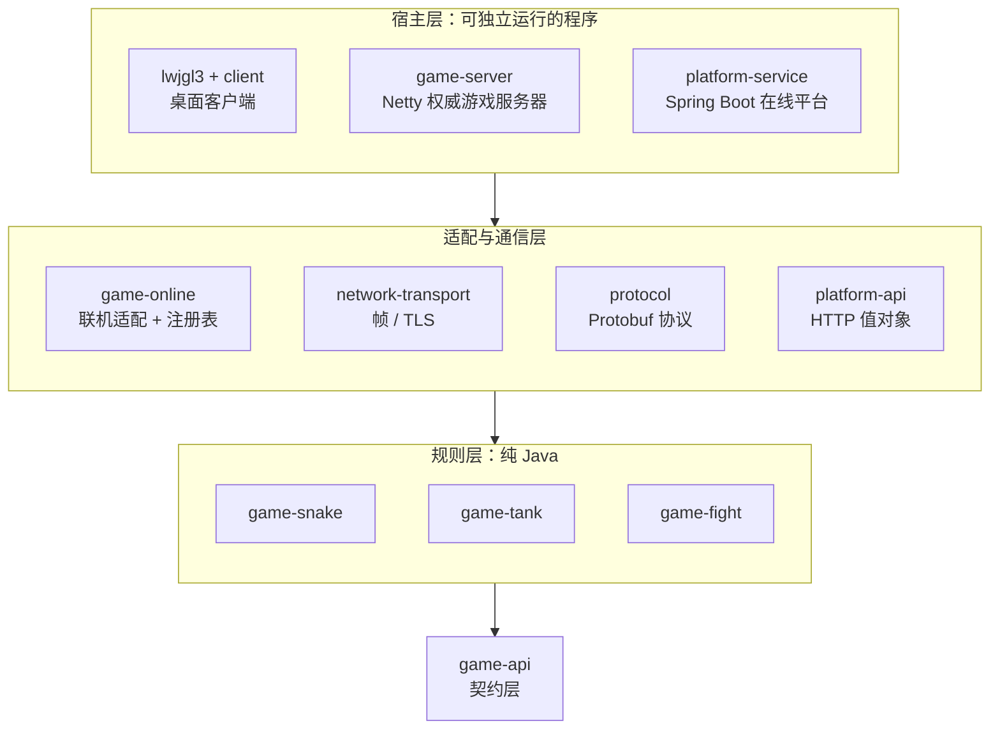

# 01 扩展性设计总览

## 1. 设计目标

GameCore 要承载多款玩法差异很大的游戏：Snake 按格子离散移动，Tank 在连续坐标里碰撞，格斗有跳跃、平台和动作状态机。如果平台试图统一“实体”“碰撞”“地图”，每加一款游戏都要改平台。因此本项目只统一**怎样运行一局游戏**，不统一**游戏里有什么**：

- 平台统一：生命周期（开始/暂停/继续/终局）、输入怎样排队生效、规则按固定步长推进、外部怎样读取状态与事件。
- 游戏自由：输入长什么样、状态长什么样、碰撞与计分怎样算、画面怎样画。

## 2. 分层结构与依赖方向

图中箭头表示层与层之间的依赖方向，只向下、不反向。上层不一定依赖下一层的全部模块，逐模块的直接依赖见下表（测试依赖未列出，完整内容以各模块 `build.gradle` 为准）。

| 模块 | 直接依赖的工程模块 |
| --- | --- |
| `lwjgl3` | `client` |
| `client` | `game-api`、三个规则模块、`game-online`、`network-transport`、`platform-api` |
| `game-server` | `game-api`、`game-tank`、`game-online`、`protocol`、`network-transport`、`platform-api` |
| `platform-service` | `game-online`、`platform-api` |
| `game-online` | `game-api`、三个规则模块、`protocol` |
| `network-transport` | `protocol` |
| `game-snake`、`game-tank`、`game-fight` | `game-api` |
| `game-api`、`protocol`、`platform-api` | 无 |

三条规则保证了扩展方向：

1. **依赖只向内指**。规则层只依赖 game-api；适配层依赖规则层；宿主层依赖适配层。没有任何箭头从规则层指向外层。
2. **契约在最内层**。game-api 不依赖任何工程模块，也不依赖 libGDX、Netty、Protobuf、Spring。
3. **宿主之间互不依赖**。client 的生产代码不依赖 game-server，两者通过 protocol + network-transport 交互；client 的 `testImplementation project(':game-server')` 仅用于回环联机测试。

这些规则不是约定，而是 Gradle 编译期强制：规则模块类路径上没有图形/网络库，写出依赖它们的代码会直接编译失败。

## 3. 扩展点总表

接入一款游戏涉及的全部扩展点如下。“实现”表示新游戏要提供一个实现类；“登记”表示在一个显式列表里加一行。

| # | 扩展点 | 类型 | 位置 | 新游戏要做的事 |
| --- | --- | --- | --- | --- |
| E1 | `GameSession<I,S>` | 实现 | game-api `session` 包 | 规则会话：生命周期、`submitInput`、`tick`、`snapshot`、`events` |
| E2 | `GameFactory<I,S>` | 实现 | game-api `online` 包 | 联机适配：类型元数据、默认/校验配置、创建会话、编解码、选项白名单、测试 Bot |
| E3 | `GameInputCodec<I>` / `GameSnapshotCodec<S>` | 实现 | game-api `online` 包 | 输入/快照与字节互转；声明持续命令与中立命令 |
| E4 | `games.proto` 中 `GameInput` / `GameSnapshot` 的 oneof | 登记 | protocol | 为新游戏增加一个负载分支及其消息 |
| E5 | `dev.gamecore.online.GameRegistry.builtIn()` | 登记 | game-online | 加入新工厂；服务器、平台、在线客户端自动可见 |
| E6 | `GameModule` / `GameDescriptor` | 实现 + 登记 | game-api 契约，client `registry.GameRegistry.builtIn()` 登记 | 大厅卡片、简介、模式列表 |
| E7 | `GameCoreClient.createGameScreen` | 登记 | client | 本地模式路由到新页面 |
| E8 | `OnlineGameView` + `OnlineGameViews.VIEWS` | 实现 + 登记 | client `network` 包 | 在线页面中的游戏专属输入与展示 |
| E9 | `SessionFactory<C,I,S>`（可选） | 实现 | game-api `replay` 包 | 需要进程内录像重模拟校验时提供 |

E1–E3 是新游戏真正的“业务代码”；E4–E8 每处都只是一行或一个分支的登记。具体做法见 [05-新增一款游戏](05-新增一款游戏.md)。

## 4. 接入后自动继承的能力

完成上述扩展点后，新游戏**不写任何额外代码**即可获得：

| 能力 | 由谁提供 | 说明 |
| --- | --- | --- |
| 固定步长推进、事件逐步发布 | [SessionLoop](../game-api/src/main/java/dev/gamecore/api/session/SessionLoop.java)、[FixedStepClock](../client/src/main/java/dev/gamecore/client/timing/FixedStepClock.java) | 画面帧率与规则速度解耦 |
| 有界、按序号去重的输入队列 | [SessionInputs](../game-api/src/main/java/dev/gamecore/api/session/SessionInputs.java) | 单 Tick 最多 256 条，只接收下一 Tick |
| 权威房间、单写入者线程 | [RoomActor](../game-server/src/main/java/dev/gamecore/server/multigame/RoomActor.java)、[RoomHost](../game-server/src/main/java/dev/gamecore/server/multigame/RoomHost.java) | 网络线程不执行规则 |
| 输入身份/序号/Tick/世代校验、received 与 executed 确认 | RoomActor | 客户端不能自报槽位 |
| 选择/准备/开场/暂停/重开的房间协调 | RoomActor | 规则会话只看到 start/pause/resume |
| 快照覆盖式发送、可靠消息有界队列 | [AsyncOutbound](../network-transport/src/main/java/dev/gamecore/network/transport/AsyncOutbound.java) | 慢客户端不拖垮服务器 |
| 状态哈希与文件录像 | [StateHashes](../game-online/src/main/java/dev/gamecore/online/runtime/StateHashes.java)、[ReplayStore](../game-server/src/main/java/dev/gamecore/server/devtools/ReplayStore.java)、[ReplayPlayer](../game-server/src/main/java/dev/gamecore/server/devtools/ReplayPlayer.java) | 回放先重模拟校验再播放 |
| 平台建房、票据、结算 | [LobbyService](../platform-service/src/main/java/dev/gamecore/platform/LobbyService.java)、[MatchService](../platform-service/src/main/java/dev/gamecore/platform/MatchService.java) | 平台按注册表读游戏 ID、版本、人数 |
| 通用在线页面 | [OnlineArenaScreen](../client/src/main/java/dev/gamecore/client/screen/OnlineArenaScreen.java)、[RemoteArenaSession](../client/src/main/java/dev/gamecore/client/network/RemoteArenaSession.java) | 连接、房间状态、输入世代、插值时间线 |

“自动继承”指代码路径对新游戏通用；新游戏仍须用自己的测试证明它在这些路径上行为正确（见 05 第 4 节）。

## 5. 架构不变量

扩展时必须保持的约束，违反任何一条都会破坏“平台不认识游戏”的前提：

1. **规则纯 Java、无 IO**：规则不读文件、不访问网络、不调用 UI；地图等资源在工厂构造时加载（如 `TankFactory.MAPS`），Tick 中不做阻塞 IO。
2. **输入只是意图**：输入不携带结果（坐标、伤害、胜负），规则决定是否生效。
3. **快照是只读投影**：对外发布不可变值，不泄露内部可变对象；渲染、网络、测试都只读快照。
4. **单写入者**：一局会话只在一个线程上创建、推进、关闭（[GameInstance](../game-online/src/main/java/dev/gamecore/online/runtime/GameInstance.java) 运行时检查 owner 线程）。
5. **显示不参与判定**：特效、插值、材质只影响画面；伤害、绑定、冷却等必须写在规则里，否则服务器和回放无法复现。
6. **所有队列有界**：输入、邮箱、发送队列、录像都有上限，溢出时拒绝或断开，而不是无限增长。
7. **不在共享层按游戏分支**：RoomActor、Netty 处理器、平台业务中不出现 `if (gameId == "tank")` 式分派；差异由工厂和编解码承担。
