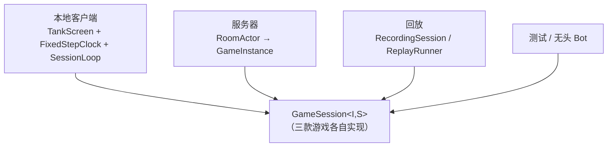

# 02 规则内核契约：一个契约，多个宿主

扩展体系的地基是 game-api 中的 `GameSession<I, S>`。理解它，就理解了为什么三款差异巨大的游戏能被同一套客户端、服务器和回放驱动。

## 1. 核心关系

```text
下一步内部世界 = 本步内部世界 + 按确定顺序应用的输入 + 游戏规则
只读快照       = 内部世界的对外投影
事件           = 本步已经发生的事实
```

第一行是概念表达。内部世界还可能包含随机数状态、Bot 状态、动作缓冲；快照不一定包含全部内部状态，所以**不能把快照塞回去当存档**——回放是从配置与 seed 重建会话再重放输入（见第 6 节）。

## 2. GameSession<I, S>：最小契约

源码：[GameSession.java](../game-api/src/main/java/dev/gamecore/api/session/GameSession.java)

```java
public interface GameSession<I, S> {
    void start(); void pause(); void resume();        // 生命周期
    boolean submitInput(PlayerInput<I> input);        // 玩家想做什么
    void tick();                                      // 规则前进一步
    S snapshot();                                     // 外部能看到什么
    SessionState state(); long tickNumber(); int ticksPerSecond();
    List<GameEvent> events();                         // 这一步发生了什么
    default boolean isFinished() { return state() == SessionState.FINISHED; }
}
```

两个类型参数是扩展的关键：

| 游戏 | 会话实现 | 输入 I | 快照 S | 规则频率 |
| --- | --- | --- | --- | --- |
| Snake | [SnakeGameSession](../game-snake/src/main/java/dev/gamecore/snake/SnakeGameSession.java) | `Direction` | `SnakeSnapshot` | 20 Hz |
| Tank | [TankSession](../game-tank/src/main/java/dev/gamecore/tank/TankSession.java) | `TankCommand` | `TankSnapshot` | 60 Hz |
| 终极格斗 | [FightSession](../game-fight/src/main/java/dev/gamecore/fight/FightSession.java) | `FightCommand` | `FightSnapshot` | 60 Hz |

- **泛型保留类型安全**：Tank 会话在编译期就不能收到 `Direction.UP`。
- **契约刻意很小**：没有规定实体、组件、碰撞、地图或渲染。Snake 用格子，Tank 用连续坐标，Fight 用平台和动作状态机，都满足同一接口。
- **不强制继承**：TankSession 包装 TankGame，SnakeGameSession 包装 SnakeGame，FightSession 自身承载较多规则。实现方式由游戏自选，没有庞大基类。
- **接口不创建线程或定时器**：何时调用 `tick()` 完全由宿主决定，这正是同一规则能被不同宿主驱动的原因。

## 3. 输入：意图而非结果

源码：[PlayerInput](../game-api/src/main/java/dev/gamecore/api/session/PlayerInput.java)、[SessionInputs](../game-api/src/main/java/dev/gamecore/api/session/SessionInputs.java)、[TankCommand](../game-tank/src/main/java/dev/gamecore/tank/TankCommand.java)

```java
public record PlayerInput<I>(long tick, int player, long sequence, I value) { … }
public record TankCommand(int throttle, int turn, boolean fire) { … }
```

`PlayerInput` 把任意游戏的命令包装成可排序的模拟输入：目标 Tick、玩家槽位（从 0 开始）、序号、命令值。`SessionInputs` 是平台提供的通用队列：只接收下一 Tick、拒绝重复序号、单 Tick 最多 `MAX_PER_TICK = 256` 条，按序号确定应用顺序。新游戏直接复用它，无需自己处理排序与上限。

`submitInput` 返回 true 只表示**进入队列**，不表示规则认可了效果。`TankCommand(1, 0, false)` 只说“向前”，墙、对手、冷却仍由规则判断。

## 4. 快照：规则与外界之间的防火墙

源码：[TankSnapshot](../game-tank/src/main/java/dev/gamecore/tank/TankSnapshot.java)

TankGame 内部的 Tank、Bullet 是私有可变对象；对外发布的是新建的 `TankSnapshot` 值，构造时对列表做 `List.copyOf`。Java `record` 不会自动深度不可变，这些防御性复制是维持边界的必要代码。

```text
TankGame 内部可变对象 ──新建值──> TankSnapshot ──> TankBoard（渲染） / Codec（网络） / 测试断言
```

因为所有外部消费者只读快照，**渲染可以重写而不碰规则，网络可以编码同一快照，测试可以直接断言快照**——三者互不影响。

## 5. 事件：让表现跟随事实

源码：[GameEvent](../game-api/src/main/java/dev/gamecore/api/event/GameEvent.java)、[SessionLoop](../game-api/src/main/java/dev/gamecore/api/session/SessionLoop.java)、[EventBus](../game-api/src/main/java/dev/gamecore/api/event/EventBus.java)

`GameEvent` 是 sealed 接口，提供 `PlayerDied`、`MatchEnded`、`ScoreChanged`、`HealthChanged`、`Effect` 五种通用事件。`SessionLoop.tick()` 仅在规则实际前进后发布本步事件，客户端订阅后播放音效、粒子。伤害已在规则里结算，粒子只是表现；监听器抛异常不会回滚规则步。

游戏专属的表现事实（如格斗的命中 Impact、大招 Ritual）不扩展 `GameEvent`，而是放进该游戏自己的快照，由该游戏的渲染器读取。这样通用事件保持稳定，游戏差异留在游戏内部。代价见 [06](06-扩展边界与演进方向.md)。

## 6. 同一份规则，四种宿主



| 宿主 | 怎样驱动会话 | 入口 |
| --- | --- | --- |
| 本地客户端 | 每帧由 `FixedStepClock` 算出应走几步（每帧最多接受 250 ms、最多 5 步，超额整步丢弃），每步采样输入 → `submitInput` → `SessionLoop.tick()` → `snapshot()` 交给 Board | [TankScreen](../client/src/main/java/dev/gamecore/client/screen/TankScreen.java)、[FixedStepClock](../client/src/main/java/dev/gamecore/client/timing/FixedStepClock.java) |
| 权威服务器 | Room 所属线程收集校验后的输入，经 `GameInstance.step()` 提交并 `tick()` | [03-在线扩展点](03-在线扩展点.md) |
| 回放 | `RecordingSession` 是 `GameSession` 的装饰器，记录有效输入、生命周期和实际前进；`ReplayRunner` 用同一配置与 seed 新建会话重放并比对 | [RecordingSession](../game-api/src/main/java/dev/gamecore/api/replay/RecordingSession.java)、[ReplayRunner](../game-api/src/main/java/dev/gamecore/api/replay/ReplayRunner.java) |
| 测试 | 直接 new 会话、提交输入、断言快照与事件 | [TankSessionContractTest](../game-tank/src/test/java/dev/gamecore/tank/TankSessionContractTest.java) |

`RecordingSession` 值得单独一提：它自身实现 `GameSession`，包住任意会话即可获得录像能力，**被包装的游戏毫不知情**。这是“通过组合而非修改来扩展”的直接例子。目前生产代码中实现进程内回放工厂 `SessionFactory<C,I,S>` 的是 [FightSessionFactory](../game-fight/src/main/java/dev/gamecore/fight/FightSessionFactory.java)；服务器文件录像则走第 03 篇的通用字节路径，三款游戏都覆盖。

**画面帧率与规则频率是两个量。** 60 FPS 下每帧约走一个 60 Hz 规则步，30 FPS 下约走两步，144 FPS 下部分帧不推进规则。Tank 的 `MOVE_SPEED = 3.2` 格/秒、`TICKS_PER_SECOND = 60`，每步位移固定为 3.2/60 格，与显示器刷新率无关。

## 7. 示例：一次 Tank 移动如何穿过内核

按这个顺序单步阅读，可以看清“意图 → 规则 → 快照”的完整链路：

1. [TankSession.tick](../game-tank/src/main/java/dev/gamecore/tank/TankSession.java)：排空有序输入交给 TankGame；需要时让 Bot 根据快照产生输入；执行规则并生成本步事件。
2. [TankGame.tick](../game-tank/src/main/java/dev/gamecore/tank/TankGame.java)：RUNNING 检查 → Tick+1 → 双方移动 → 冷却与开火 → 子弹推进并**累计**双方伤害 → **一起**扣血 → 判终局/维修。先累计再扣血，允许同 Tick 互毁，不偏袒先更新的一方。
3. [TankMovement](../game-tank/src/main/java/dev/gamecore/tank/TankMovement.java)：`propose()` 计算候选朝向和位移，`resolve()` 分轴检查地图碰撞与双车重叠。碰撞依据 TankMap，纹理不参与。
4. [TankRules](../game-tank/src/main/java/dev/gamecore/tank/TankRules.java)：冷却、子弹、伤害、维修、胜负等纯函数。
5. `TankGame.snapshot()`：生成新的只读 `TankSnapshot`。

练习：在 `TankSessionContractTest.lastCommandBySequenceWinsAndHeldCommandPersistsUntilExplicitIdle` 中设断点，预测序号 2 与 4 哪条最后生效、第二个 Tick 无新输入为何仍移动、`IDLE` 如何归零——一次贯通泛型输入、确定顺序、持续命令和快照。

## 8. 新游戏实现 GameSession 的检查清单

- [ ] 输入类型是不可变值，只表达意图，构造时校验范围。
- [ ] 快照类型是不可变值，集合做防御性复制，不暴露内部对象。
- [ ] 同一 seed、同一配置、同一输入序列 → 同一快照序列（确定性）。随机数只由 seed 初始化，不读系统时间。
- [ ] READY/PAUSED/FINISHED 时 `tick()` 不推进；暂停清理持续输入。
- [ ] `submitInput` 拒绝非法槽位、非 RUNNING 状态和 Bot 槽位输入。
- [ ] `events()` 只返回最近一个已完成 Tick 的不可变批次，终局事件只发一次。
- [ ] 规则模块 `build.gradle` 只依赖 `game-api`。
