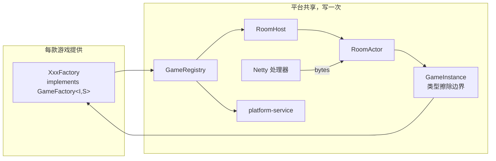
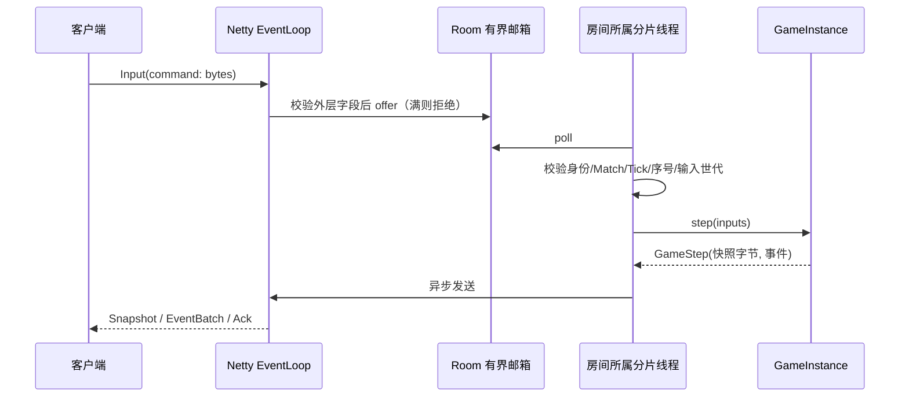

# 03 在线扩展点：服务器为何不需要知道游戏种类

联机是“可扩展”最难的部分：服务器要调度房间、校验输入、发送快照、录像、对接平台，却不能为每款游戏写一套。GameCore 的做法是把**游戏差异压缩进一个工厂对象**，再在适配边界做一次类型擦除，让服务器只处理字节和统一的步进结果。

## 1. 整体链路



## 2. GameFactory：一款游戏交给联机宿主的全部信息

源码：[GameFactory](../game-api/src/main/java/dev/gamecore/api/online/GameFactory.java)

| 方法 | 提供什么 | 平台用它做什么 |
| --- | --- | --- |
| `type()` → [GameType](../game-api/src/main/java/dev/gamecore/api/online/GameType.java) | ID、展示版本、规则版本、人数区间、规则频率、默认房间频率 | 协商版本、限制人数、计算每个房间步执行几个规则子步 |
| `defaults()` / `validate()` | 默认受信配置及其白名单校验（[GameRuleConfig](../game-api/src/main/java/dev/gamecore/api/online/GameRuleConfig.java)） | 建房、换图、重开前校验配置 |
| `sessions()` → [GameSessionFactory](../game-api/src/main/java/dev/gamecore/api/online/GameSessionFactory.java) | 用配置 + seed 创建 `GameSession<I,S>` | 在 Room 线程创建规则会话 |
| `inputs()` → [GameInputCodec](../game-api/src/main/java/dev/gamecore/api/online/GameInputCodec.java) | 输入与字节互转；`held()` 持续命令语义；`neutral()` 租约到期的中立命令 | 校验网络输入、断续收包时决定是否沿用上一条命令 |
| `snapshots()` → [GameSnapshotCodec](../game-api/src/main/java/dev/gamecore/api/online/GameSnapshotCodec.java) | 快照与字节互转；`outcome()` 胜负投影；`entityCount()` | 发送快照、上报结果、记录指标 |
| `select()` | 本槽位允许修改的选项（如 Tank 只允许 P1 选 `crossfire`/`ruins`） | 房间内选角选图，不接受客户端上传完整配置 |
| `openingMillis()` | 开场演出时长 | 房间处于 OPENING 时规则保持 READY、Tick 为零 |
| `bot()` | 无头测试客户端的合法意图 | 负载与验收工具 |

平台在类型层面也设了硬边界：`GameType` 要求 ID 匹配 `[a-z][a-z0-9-]{0,31}`、人数 ≤ 8、规则频率 ≤ 120 且能被默认房间频率整除；`GameRuleConfig` 选项最多 16 个、键 ≤ 32 字符、值 ≤ 64 字符。新游戏不可能通过配置把房间撑爆。

**实例**：[TankFactory](../game-online/src/main/java/dev/gamecore/online/tank/TankFactory.java) 的 `sessions()` 直接返回原有的 `TankSession`——没有“网络版 TankGame”。地图在类加载时缓存，房间 Tick 不读文件。三个工厂的类型：

| 工厂 | ID | 规则版本 | 人数 | 规则 Hz / 默认房间 Hz |
| --- | --- | --- | --- | --- |
| [TankFactory](../game-online/src/main/java/dev/gamecore/online/tank/TankFactory.java) | `tank` | `tank/1` | 2 | 60 / 30（每房间步 2 个规则子步） |
| [SnakeFactory](../game-online/src/main/java/dev/gamecore/online/snake/SnakeFactory.java) | `snake` | `snake/1` | 2 | 20 / 20 |
| [FightFactory](../game-online/src/main/java/dev/gamecore/online/fight/FightFactory.java) | `fight` | `fight/7` | 2 | 60 / 60 |

## 3. GameRegistry：唯一的在线登记处

源码：[dev.gamecore.online.GameRegistry](../game-online/src/main/java/dev/gamecore/online/GameRegistry.java)

```java
public static GameRegistry builtIn() {
    return new GameRegistry(List.of(new TankFactory(), new SnakeFactory(), new FightFactory()));
}
```

构造时拒绝重复 ID、校验每个工厂的默认配置，之后不可变；`require(id)` 对未知 ID 抛异常。**这一行列表是服务器、平台和在线客户端共同的事实来源**：

| 使用者 | 怎样使用注册表 |
| --- | --- |
| [RoomHost](../game-server/src/main/java/dev/gamecore/server/multigame/RoomHost.java) | `registry.require(spec.game())` 取工厂创建 RoomActor；`defaults(games)` 为每款已注册游戏生成默认房间 |
| [ReplayPlayer](../game-server/src/main/java/dev/gamecore/server/devtools/ReplayPlayer.java) | 按录像头里的游戏 ID 取工厂重模拟 |
| [LobbyService](../platform-service/src/main/java/dev/gamecore/platform/LobbyService.java) | `games()` 列出全部游戏；建房时 `require(gameId)`；票据携带版本 |
| [OnlineArenaScreen](../client/src/main/java/dev/gamecore/client/screen/OnlineArenaScreen.java) | 按票据中的游戏 ID 取工厂编解码 |

注意 client 里还有一个同名类 `dev.gamecore.client.registry.GameRegistry`，它只管大厅目录（见 [04](04-客户端扩展点.md)）。两个注册表职责不同：**大厅里多一张卡片不会自动获得联机能力，反之亦然。**

## 4. GameInstance：类型擦除只发生在这一处

源码：[GameInstance](../game-online/src/main/java/dev/gamecore/online/runtime/GameInstance.java)

RoomActor 需要同时持有 Tank、Snake、Fight 的房间，但不能（也不该）带着各自的 `<I,S>` 泛型。`GameInstance.create(factory, config, seed)` 在内部仍以同一组 `I`、`S` 调用工厂和会话，对外只暴露统一接口：

```java
GameStep initial();  void start();  void pause();  void resume();
void validateInput(byte[] command);  byte[] held(byte[] command);  byte[] neutral();
GameStep step(List<AppliedInput> inputs);   // 解码 → submitInput → tick → 编码快照
void close();
```

`step()` 把每条 `AppliedInput` 解码为 `PlayerInput<I>` 提交，推进一步，再把快照编码为字节、把事件转换为协议值，打包成 [GameStep](../game-online/src/main/java/dev/gamecore/online/runtime/GameStep.java)。创建时记录 owner 线程，其他线程调用直接抛 `IllegalStateException`——单写入者不是口头约定，而是运行时检查。

**泛型类型安全保留在游戏内部，类型擦除被限制在一个约 40 行的边界里**，这是本项目在“类型安全”与“异构游戏共存”之间的取舍。

## 5. RoomActor：只处理字节与协调状态

源码：[RoomActor](../game-server/src/main/java/dev/gamecore/server/multigame/RoomActor.java)、[RoomHost](../game-server/src/main/java/dev/gamecore/server/multigame/RoomHost.java)、[NettyMultiGameServer](../game-server/src/main/java/dev/gamecore/server/multigame/NettyMultiGameServer.java)



RoomActor 中没有任何按游戏 ID 的分支。它对所有游戏一视同仁地做：

- **调度**：RoomHost 按房间 ID 稳定分配到逻辑分片（1–8 个单线程调度器），一个线程可推进多个房间。
- **子步**：`substeps = simulationTps / roomTps`，Tank 默认每房间步执行 2 个 60 Hz 规则子步。降低房间频率不会把规则改成大步长。
- **输入校验**：槽位由连接查座位得到，客户端不能自报；校验 roomId、matchId、gameId、序号、目标 Tick（过远未来拒绝）、负载、输入世代，最后交给 `validateInput()` 由游戏编解码器校验内容。
- **确认语义**：`Ack.received` 表示收到，`Ack.executed` 表示已实际应用；排进未来队列不算生效。
- **协调状态**：WAITING / SETUP / OPENING / RESETTING / ABORTED 等房间状态独立于规则会话的 READY / RUNNING / PAUSED / FINISHED。选择变化递增 `revision` 使旧准备失效；清队列递增 `inputEpoch` 防止旧键跨局。
- **持续命令租约**：断续收包时按 `held()` 沿用命令，租约到期用 `neutral()` 释放，避免坦克永远自动行驶。

单写入者让同一房间的“输入、暂停、换图、重开、Tick”天然有序，无需锁；但同分片的其他房间会受某个慢房间影响，单写入者本身不等于无限扩容。

## 6. 协议：外层通用，内层按游戏

源码：[games.proto](../protocol/src/main/proto/games.proto)

```protobuf
message Input    { string room_id = 1; string match_id = 2; string game_id = 3; uint64 sequence = 4;
                   uint64 target_tick = 5; bytes command = 6; uint64 input_epoch = 7; }
message Snapshot { …; string game_id = 3; …; bytes state = 7; repeated Ack acks = 8; bytes state_hash = 9; }

message GameInput    { oneof payload { TankInput tank = 1; SnakeInput snake = 2; FightInput fight = 3; } }
message GameSnapshot { oneof payload { TankView  tank = 1; SnakeView  snake = 2; FightView  fight = 3; } }
```

- **外层**（Envelope、Join、Input、Snapshot、RoomControl、Ack…）与游戏无关，命令和状态都是不透明的 `bytes`。服务器与网络层只碰外层。
- **内层**（`GameInput` / `GameSnapshot`）由各游戏编解码器读写。用 oneof 而不是裸字节，是为了防止两款游戏的相同字段布局被误读：Tank 解码器收到 Snake 负载时 `hasTank()` 为假，直接拒绝。
- 通用事件经 [ProtocolValues](../game-online/src/main/java/dev/gamecore/online/ProtocolValues.java) 统一转换，新游戏只要使用 `GameEvent` 的五种事件就无需改动转换代码。

新增游戏需要在两个 oneof 中各加一个分支——这是有意为之的显式登记，代价见 [06](06-扩展边界与演进方向.md)。

## 7. 平台：按元数据工作，不含游戏代码

Spring 平台（platform-service）负责账户、大厅、比赛分配、票据、战绩，实时世界仍由 game-server 推进。平台对游戏的全部认知来自 `GameRegistry`：

```text
登录 → 建房（LobbyService.create: games.require(gameId)）→ 双方准备
→ 签发一次性票据（携带 gameId / gameVersion / rulesVersion）
→ 客户端连接游戏节点提交票据 → 节点后台兑换得到受信 user / slot / match
→ Room 内选择、准备、对局 → 节点经后台 outbox 提交结果 → MatchService 事务结算
```

数据库表只存 `game_id varchar(32)` 等通用列，没有按游戏的枚举或表结构。因此新游戏在 `GameRegistry` 登记后，平台的建房、票据、结算代码路径无需修改（这一结论来自代码阅读；新游戏接入时仍应补平台集成测试）。

身份与积分的边界：internal 结果接口只允许 SERVER 角色（[SecurityConfiguration](../platform-service/src/main/java/dev/gamecore/platform/SecurityConfiguration.java)）；[MatchService.finish](../platform-service/src/main/java/dev/gamecore/platform/MatchService.java) 核对比赛、版本、最终快照与 hash 后幂等结算。普通客户端不能上传积分。[PlatformGateway](../game-server/src/main/java/dev/gamecore/server/platform/PlatformGateway.java) 的 outbox 在落盘前被强杀仍有丢失窗口，不是零丢失保证。

## 8. 录像：同样走通用路径

[ReplayStore](../game-server/src/main/java/dev/gamecore/server/devtools/ReplayStore.java) 记录规范化后的实际输入字节；[ReplayPlayer](../game-server/src/main/java/dev/gamecore/server/devtools/ReplayPlayer.java) 读取录像头中的游戏 ID，从注册表取工厂，先重新模拟并核对版本、状态 hash、周期快照与事件，再构造有容量上限的只读播放索引。整条链路只依赖 `GameFactory`，新游戏注册后即可录像。可重模拟的前提是固定规则版本、配置、seed 与输入顺序，并由实际校验检测漂移——使用 Java 或实现接口本身不会自动带来确定性。
