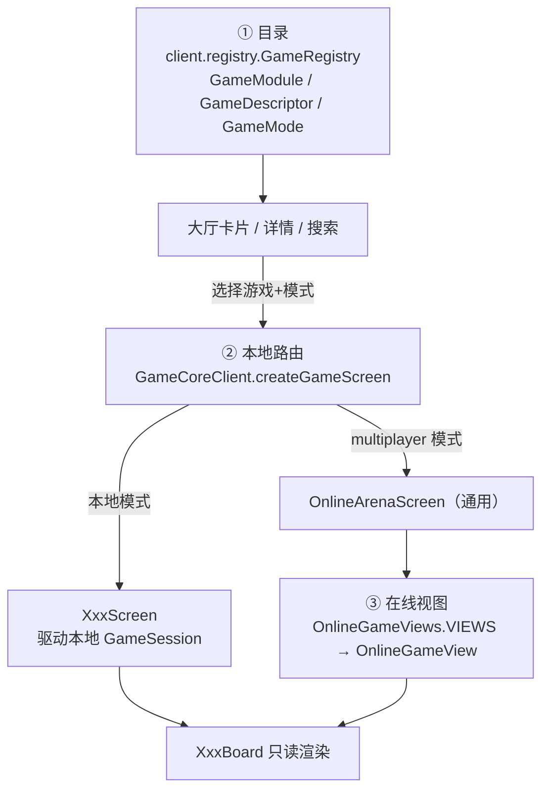

# 04 客户端扩展点：目录、本地页面与在线视图

客户端（client + lwjgl3）是一个宿主：它不实现任何规则，只做三件事——**展示目录、驱动本地会话、消费远端快照**。每件事各有一个扩展点。



## 1. 目录：大厅里出现一张卡片

源码：[GameModule](../game-api/src/main/java/dev/gamecore/api/GameModule.java)、[GameDescriptor](../game-api/src/main/java/dev/gamecore/api/GameDescriptor.java)、[GameMode](../game-api/src/main/java/dev/gamecore/api/GameMode.java)、[client.registry.GameRegistry](../client/src/main/java/dev/gamecore/client/registry/GameRegistry.java)

`GameModule` 是只有一个方法的函数式接口，返回 `GameDescriptor`（ID、名称、副标题、简介、描述、模式列表）。描述符构造时校验 ID 格式、字段完整、模式非空且不重复。客户端注册表在 `builtIn()` 中依次 `register(...)` 三款游戏，大厅首页、详情页、搜索、游戏数统计都从 `all()` 生成，**页面代码不枚举具体游戏**。

[GameRegistryTest.acceptsNewCatalogEntryWithoutChangingConsumer](../client/src/test/java/dev/gamecore/client/registry/GameRegistryTest.java) 注册了第四款虚构游戏 `third`，验证目录与搜索无需修改消费方即可包含它——这是目录可扩展的直接测试证据。

目录元数据刻意不含输入、图形或会话实现，所以它与在线注册表（[03](03-在线扩展点.md)）是两回事。

## 2. 本地路由：选择模式后打开哪个页面

源码：[GameCoreClient.createGameScreen](../client/src/main/java/dev/gamecore/client/GameCoreClient.java)

```java
private UiScreen createGameScreen(String gameId, String modeId) {
    if ("multiplayer".equals(modeId)) { return new OnlineArenaScreen(this, gameId); }
    return switch (gameId) {
        case "snake" -> new SnakeScreen(this, modeId);
        case "tank"  -> "online".equals(modeId) ? new OnlineTankScreen(this) : new TankScreen(this, modeId);
        case "fight" -> new FightScreen(this, modeId);
        default -> throw new IllegalArgumentException("No game screen: " + gameId);
    };
}
```

- 任何游戏的 `multiplayer` 模式都进入**通用的** `OnlineArenaScreen`，不需要为每款游戏写在线页面。
- 本地模式用显式 `switch` 路由。未知游戏直接抛异常；源码注释说明了原因：防止新增游戏被默认错误派发到 Tank 页面。新游戏在这里加一个 `case`。
- 大厅与独立游戏窗口复用同一入口。

本地页面（如 [TankScreen](../client/src/main/java/dev/gamecore/client/screen/TankScreen.java)）的通用骨架是：键盘采样 → `FixedStepClock` → `submitInput` → `SessionLoop.tick()` → `snapshot()` → Board；订阅 `SessionLoop.events()` 播放音效粒子。新游戏的本地页面复制这个骨架，替换输入采样与 Board 即可。页面基类 [UiScreen](../client/src/main/java/dev/gamecore/client/screen/UiScreen.java) 提供外壳、主题、背景与生命周期钩子；暂停/失焦/离页时清按键、清计时余量、解除订阅、释放资源，这些属于功能正确性。

## 3. 在线视图：通用页面里的游戏专属部分

源码：[OnlineGameView](../client/src/main/java/dev/gamecore/client/network/OnlineGameView.java)、[OnlineGameViews](../client/src/main/java/dev/gamecore/client/network/OnlineGameViews.java)、[OnlineArenaScreen](../client/src/main/java/dev/gamecore/client/screen/OnlineArenaScreen.java)、[RemoteArenaSession](../client/src/main/java/dev/gamecore/client/network/RemoteArenaSession.java)

通用在线页面负责连接、房间状态、准备/暂停/重开按钮、输入世代、快照时间线；游戏专属的部分通过 `OnlineGameView` 接口注入：

| 方法 | 职责 |
| --- | --- |
| `actor()` | 返回该游戏的棋盘 + 侧栏组件 |
| `key(key, down)` / `command()` | 采样按键，产出编码后的输入字节 |
| `snapshot(bytes)` | 解码快照并更新 Board / HUD |
| `room(state, slot)` / `connection(...)` | 根据房间状态启用或禁用选图、显示身份 |
| `events(list)` | 播放事件对应的音效与特效 |
| 选择相关默认方法 | 角色/地图选择页（格斗用到） |

注册方式是一张不可变映射：

```java
private static final Map<String,Builder> VIEWS =
    Map.of("snake", OnlineGameViews::snake, "tank", OnlineGameViews::tank, "fight", OnlineGameViews::fight);
```

视图只接收 `Host` 回调（`choose`、`register`、`ranking`）表达意图，**不直接访问连接或世界**。Snake 在线视图直接 new `SnakeFactory` 取编解码器、复用本地的 `SnakeBoard` 与 `ArenaPanels`——在线与本地共享同一套展示组件，只是数据来源不同。

数据流：

```text
GameNetworkConnection 收包（Netty 线程）
→ 不可变消息经有界邮箱交接
→ 渲染线程 RemoteArenaSession.update（校验 match 与状态 hash，不运行第二份权威会话）
→ OnlineGameView.snapshot 解码
→ Board / HUD
```

Tank/Fight 在 v2 中使用 [ArenaSnapshotTimeline](../client/src/main/java/dev/gamecore/client/network/sync/ArenaSnapshotTimeline.java)（最多 64 份样本）做显示插值、不外推；[ArenaMotion](../client/src/main/java/dev/gamecore/client/network/sync/ArenaMotion.java) 只平滑连续坐标，生命、冷却、命中、结果始终取最新权威值。插值属于显示层，不改变规则结果。

## 4. 只读渲染组件：Board

每款游戏的 Board（[SnakeBoard](../client/src/main/java/dev/gamecore/client/snake/SnakeBoard.java)、[TankBoard](../client/src/main/java/dev/gamecore/client/tank/TankBoard.java)、`fight` 包下的场景渲染器）只接收快照、不持有会话引用。因为 Board 只依赖快照类型：

- 本地页面与在线视图共用同一个 Board；
- 重写画面（如近期的 Tank 对战界面重构）不触碰规则、Bot、协议；
- 格斗的选图预览与实战共用同一个场景渲染器。

## 5. 新游戏在客户端要做的事

| 步骤 | 位置 | 是否必需 |
| --- | --- | --- |
| 在 `client.registry.GameRegistry.builtIn()` 注册描述符与模式 | client `registry` | 必需（否则大厅不可见） |
| 编写 `XxxBoard`（只读快照渲染）与 `XxxControls`（键位采样） | client 新包 `xxx` | 必需 |
| 编写本地 `XxxScreen` 并在 `createGameScreen` 加 `case` | client `screen` | 有本地玩法时必需 |
| 实现 `OnlineGameView` 并加入 `VIEWS` | client `network` | 有在线玩法时必需 |
| 在 `ThemeManager.accent`、`ArenaArt` 中给出识别色与封面 | client `ui` | 建议（未登记时回退为格斗色/坦克封面，见 06） |
| 增加桌面冒烟测试任务 | lwjgl3 `smokeTest` | 建议 |
