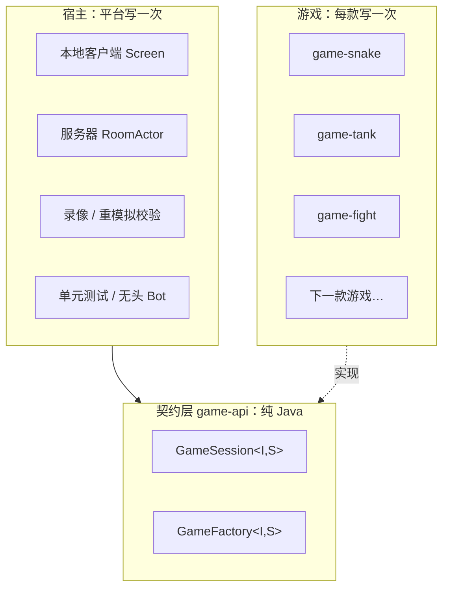

# GameCore 可扩展游戏平台架构说明

> 一句话：**平台只认识“一局游戏”的抽象契约，不认识任何具体游戏**。Snake、Tank、终极格斗三款游戏各自实现这份契约，于是本地客户端、权威服务器、录像回放、在线平台都能驱动它们，而无需为每款游戏重写一遍。

本目录面向第一次阅读 GameCore 的人：先讲清“可扩展”具体指什么、靠哪些代码保证，再给出接入新游戏的步骤和当前尚未做到的边界。所有结论均可在文中链接的源码里核对。

## “可扩展”在本项目中的含义

| 维度 | 平台提供（写一次） | 每款游戏提供（每款写一次） | 关键代码 |
| --- | --- | --- | --- |
| 规则 | 生命周期、有序输入队列、固定步长、事件发布 | 输入类型 `I`、快照类型 `S`、规则实现 | [GameSession](../game-api/src/main/java/dev/gamecore/api/session/GameSession.java) |
| 联机 | 房间单写入者调度、有界邮箱、Netty 收发、确认/重连、录像 | 工厂、输入/快照编解码、受信配置白名单 | [GameFactory](../game-api/src/main/java/dev/gamecore/api/online/GameFactory.java)、[GameInstance](../game-online/src/main/java/dev/gamecore/online/runtime/GameInstance.java) |
| 客户端 | 大厅、设置、主题、固定步长时钟、通用在线页面 | 本地页面、棋盘渲染、在线展示适配 | [OnlineGameView](../client/src/main/java/dev/gamecore/client/network/OnlineGameView.java) |
| 平台 | 账户、建房、票据、结算、战绩 | 无需游戏专属代码（按注册表读取元数据） | [LobbyService](../platform-service/src/main/java/dev/gamecore/platform/LobbyService.java) |

“可扩展”**不是**“丢进一个 JAR 就能运行”。当前采用**编译期模块 + 显式注册**：新增一款游戏要新建规则模块，并在少量明确的装配点登记。这样做牺牲了热插拔，换来类型检查、可审查的接入点和不受信代码不进入服务器。详见 [06-扩展边界](06-扩展边界与演进方向.md)。

## 一张图看懂

宿主只依赖契约；游戏只依赖契约。两侧互不认识，所以一侧变化不会波及另一侧。这一点由 Gradle 依赖强制：三个规则模块的 `build.gradle` 只有 `api project(':game-api')`，编译期根本看不到 libGDX、Netty、Spring。

## 阅读路线

| 顺序 | 文档 | 回答的问题 |
| --- | --- | --- |
| 1 | [01-扩展性设计总览](01-扩展性设计总览.md) | 系统分几层？依赖为什么这样走？扩展点一共有哪些？ |
| 2 | [02-规则内核契约](02-规则内核契约.md) | 一款游戏最少要实现什么？为什么同一份规则能被四种宿主复用？ |
| 3 | [03-在线扩展点](03-在线扩展点.md) | 服务器为何不需要知道游戏种类？新游戏接入后自动获得哪些能力？ |
| 4 | [04-客户端扩展点](04-客户端扩展点.md) | 大厅卡片、本地页面、在线展示分别在哪里登记？ |
| 5 | [05-新增一款游戏](05-新增一款游戏.md) | 按什么顺序、改哪些文件、用哪些测试证明接入成功？ |
| 6 | [06-扩展边界与演进方向](06-扩展边界与演进方向.md) | 哪些地方目前仍需手工修改？哪些能力尚未实现？ |
| 7 | [07-三款游戏的扩展实现](07-三款游戏的扩展实现.md) | Snake、Tank、格斗分别怎样实现同一组扩展点？平台替它们做了什么？ |
| 附 | [模块说明](模块说明/) | 12 个 Gradle 模块各自在扩展体系中的角色、入口与验证命令 |

只有十分钟：读本页 + 01 + 07。准备动手接入新游戏：按 02 → 03 → 04 → 05 顺序读。

## 模块一览

| 层 | 模块 | 在扩展体系中的角色 |
| --- | --- | --- |
| 契约 | [game-api](模块说明/game-api.md) | 定义全部扩展点；不依赖任何其他模块 |
| 游戏 | [game-snake](模块说明/game-snake.md)、[game-tank](模块说明/game-tank.md)、[game-fight](模块说明/game-fight.md) | 三个扩展实现，纯 Java 规则 |
| 适配 | [game-online](模块说明/game-online.md) | 每款游戏的联机适配器 + 唯一的在线注册表 |
| 协议/传输 | [protocol](模块说明/protocol.md)、[network-transport](模块说明/network-transport.md) | 与游戏无关的外层信封 + 每款游戏的内层负载 |
| 宿主 | [client](模块说明/client.md)、[lwjgl3](模块说明/lwjgl3.md)、[game-server](模块说明/game-server.md) | 驱动任意 `GameSession` 的运行环境 |
| 平台 | [platform-api](模块说明/platform-api.md)、[platform-service](模块说明/platform-service.md) | 账户/大厅/结算，按注册表元数据工作 |

## 相关入口

- 需求与规格：01-需求分析与skills封装
- 网络通信：[03-客户端与服务器网络通信](../03-客户端与服务器网络通信/README.md)
- 测试与验证：04-测试与验证
