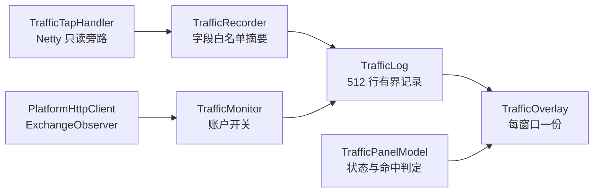

# client：libGDX 客户端

> 扩展角色：**宿主**。展示游戏目录、驱动本地 `GameSession`、消费远端只读快照；不实现任何规则。三个客户端扩展点（目录、本地路由、在线视图）都在本模块。

## 职责

页面与导航、只读游戏展示（Board/HUD/特效）、键位采样、固定步长时钟、平台 HTTP 会话、在线连接与快照时间线、资源与多窗口生命周期。现有客户端粒子特效保留。

## 在扩展体系中的位置

| 扩展点 | 位置 | 新增游戏时 |
| --- | --- | --- |
| E6 目录 | [registry/GameRegistry](../../client/src/main/java/dev/gamecore/client/registry/GameRegistry.java) `builtIn()` | 注册描述符与模式 |
| E7 本地路由 | [GameCoreClient.createGameScreen](../../client/src/main/java/dev/gamecore/client/GameCoreClient.java) | 加一个 `case` |
| E8 在线视图 | [network/OnlineGameViews](../../client/src/main/java/dev/gamecore/client/network/OnlineGameViews.java) `VIEWS` + [OnlineGameView](../../client/src/main/java/dev/gamecore/client/network/OnlineGameView.java) 实现 | 加一项映射与一个视图 |
| 通用在线页面 | [screen/OnlineArenaScreen](../../client/src/main/java/dev/gamecore/client/screen/OnlineArenaScreen.java)、[network/RemoteArenaSession](../../client/src/main/java/dev/gamecore/client/network/RemoteArenaSession.java) | 不改 |
| 通用本地设施 | [timing/FixedStepClock](../../client/src/main/java/dev/gamecore/client/timing/FixedStepClock.java)、[screen/UiScreen](../../client/src/main/java/dev/gamecore/client/screen/UiScreen.java)、`ui/ThemeManager` | 不改（识别色/封面建议补登记，见 [06](../06-扩展边界与演进方向.md)） |

详见 [04-客户端扩展点](../04-客户端扩展点.md)。

## 代码组织（`dev.gamecore.client`）

| 包 | 内容 |
| --- | --- |
| 根包 | `GameCoreClient`：应用入口、导航、页面路由、窗口共享资源 |
| `registry`、`navigation` | 大厅目录注册表、导航栈 |
| `screen` | `UiScreen` 外壳；首页/详情/设置/平台页；`SnakeScreen`、`TankScreen`、`FightScreen` 本地页；`OnlineArenaScreen` 通用在线页；`OnlineTankScreen` 旧 v1 页 |
| `snake`、`tank`、`fight` | 各游戏的 Board、Controls、HUD 与特效（格斗含选择页、开场、场景渲染、胜利演出） |
| `network`、`network/sync` | 在线视图端口、远端会话、输入调度、快照时间线与插值 |
| `platform` | 平台 HTTP 会话（有界后台工作者） |
| `traffic` | 服务器交互记录：开发账户开关、有界记录、协议摘要、悬浮面板（阶段 14） |
| `ui`、`assets`、`effects` | 主题、通用面板、背景、资源管理、粒子 |
| `settings`、`timing`、`window` | 设置与键位、固定步长时钟、窗口生命周期 |

线程边界：Netty 收包与 HTTP 请求在后台，经有界邮箱交给渲染线程；渲染线程拥有页面、远端会话与 Board。

## 依赖

- 运行/编译（`api`）：`game-api`、`game-snake`、`game-tank`、`game-fight`、libGDX。
- 运行/编译（`implementation`）：`network-transport`、`game-online`、`platform-api`、gdx-freetype、netty-resolver-dns。
- 测试：`game-server`（回环联机测试）。生产代码不依赖 game-server。

## 验证

```powershell
.\gradlew.bat :client:test --console=plain
```

图形验收见 [lwjgl3](lwjgl3.md)；[GameRegistryTest](../../client/src/test/java/dev/gamecore/client/registry/GameRegistryTest.java) 中 `acceptsNewCatalogEntryWithoutChangingConsumer` 验证新增目录项无需修改消费方。

---

以下为界面阶段（阶段 13）的实现说明。

## 夜墨信号大厅界面

大厅类页面（游戏库、详情、设置、在线平台、场景预览）共用 `UiScreen` 外壳与 `ThemeManager.lobby()` 主题；竞技页面（Snake/Tank/Fight 舞台与 HUD）仍用原竞技主题与原背景图。内嵌 Snake 的外壳（顶栏/页脚/背景）用大厅主题，棋盘与面板保持竞技配色。

- 设计原则：墨黑底 + 中性灰阶表面；唯一界面强调色为信号绿（主操作、选中、焦点），三款游戏各持识别色（Snake 青绿、Tank 琥珀、格斗珊瑚红）；所有面板/按钮为右上、左下切角；左侧栏改为 64 逻辑像素顶栏，横向空间留给内容。
- 代码组织：
  - `ui/LobbyPalette` —— INK/PANEL/RAISED/TOPBAR/LINE 明度阶、SIGNAL 三档与三种游戏色；对比度由 `LobbyThemeTest` 校验。
  - `ui/LobbySurface` + `ThemeManager.surface(fill,border,stroke,spine)` —— 切角描边表面，可选 2px 焦点描边与左侧强调脊线。
  - `ui/LobbyNavDrawable` + `ThemeManager.nav(...)` —— 顶栏与页内标签导航：底沿信号绿指示线、悬停浅底、焦点切角描边。
  - `ui/TopBarDrawable`、`ui/LobbyGlyph`（LOGO/LIBRARY/ONLINE/SETTINGS/EXIT）—— 顶栏底与几何图标，均借用共享白像素。
  - `ThemeManager.cardStyle(accent)` —— 游戏卡片悬停/焦点改用游戏识别色描边；`ThemeManager.color()` 供页面直接着色时走主题映射。
  - `BackdropRenderer` —— 大厅为程序背景：墨底、四团缓慢漂移的识别色柔光、按逻辑像素等距的点阵（约千点，不随 4K 线性增长）、底部压暗。
  - `ClientAssetManager` —— 新增 `glow`（128² 径向柔光）与 `cut`（切角九宫格）两张程序纹理，由资源管理器统一持有释放。
  - `ArenaArt` —— 大厅主题下封面使用识别色暗底 + 中心柔光；竞技主题配色不变。
- 页面：首页为带脊线横幅（题眼、快速开始/在线平台、按注册目录计算的游戏数与玩法数）+ 游戏库标题/搜索 + 三张卡片；详情页左封面右信息，玩法行带 01–04 序号。
- 不变边界：除 `lobby-sidebar` 改名 `lobby-topbar` 外所有 Actor 名称、按钮语义、禁用/键盘确认、平台请求线程模型、字体字符子集均保持；新增文案只使用已打包字形（`马` 不在子集，题眼改用“即刻”）。月色花园背景图仍保留在资源中，竞技页面继续使用。
- 阅读入口：`screen/UiScreen.java`（外壳/顶栏）→ `screen/HomeScreen.java` → `ui/ThemeManager.java`；测试见 阶段 13 验证记录。

## Tank Arena 对战界面

Tank 页仍使用竞技主题（不改 `ThemeManager` 竞技色常量），本地与在线共用以下组件：

- `tank/TankBoard` —— 只读快照渲染：TMX 图层 + 原创几何坦克（阴影、双履带与履带齿、车体、炮塔、炮管）、子弹光晕、修理区呼吸光与四角括线、头顶编号与五格生命条；`overlay(title, detail, color)` 为页面可选的居中状态浮层（在线页不设置），`view()` 暴露当前快照供同屏 HUD 读取。
- `tank/TankScoreboard`（新增）—— 侧栏对阵卡的图形部分：名称 + 对称五格生命条 + VS，直接读 `TankBoard.view()`，不缓存、不接收输入。
- `ui/ArenaPanels.tank(..., scoreboard, ...)` —— 新重载：对阵卡（记分板、倒计时、文字生命读数）→ 状态条 → 选项 → 按键框 → 操作；旧签名保留并传 null。`tank-health`/`tank-time` 标签文字与在线验收比对保持不变，倒计时保持单行正文字号。
- `ui/ArenaHudText.tankBanner` —— 纯 Java 浮层文案（READY/PAUSED/FINISHED，RUNNING 为 null），由 `ArenaHudTextTest` 覆盖。
- `BackdropRenderer.draw(batch, tactical)` + `UiScreen.tacticalBackdrop()` —— `TankScreen` 覆写为 true，使用程序“战术”背景（深钢蓝、P1/P2 色柔光、48 逻辑像素网格）。
- 依赖与生命周期：均借用窗口共享的白像素/圆形/柔光纹理与字体，不新增纹理或素材；规则、Bot、协议、TMX 未改。测试见 阶段 13 验证记录。

---

以下为阶段 14 的实现说明。

## 服务器交互记录

开发账户 `testuser` 登录后，每个窗口显示一个悬浮面板，实时列出本客户端与游戏服务器、平台之间的交互。其他账户和游客不显示、不采集，也不创建绘制资源。



- 代码组织（`client/traffic`）：
  - `TrafficMonitor` —— 总开关。每帧用平台返回的用户名同步，退出、失效和换账户走同一条路径。只认用户名，不认显示名。新连接通过它取得旁路，未开启时返回 `null`，连接不安装任何处理器。
  - `TrafficRecorder` —— 一条连接一个实例，把 v2 和 v1 Tank 的 Envelope 转成展示文本。按字段白名单取值，凭证、票据和消息体不进入文本。
  - `TrafficLog` —— 线程安全的有界记录，最多 512 行，满额丢弃最旧一行。快照和输入进入 1 秒合并窗口，其余类型逐条写入。
  - `TrafficKind`、`TrafficDirection`、`TrafficEntry` —— 八种类型及识别色、方向、不可变的一行记录。
  - `TrafficPanelModel` —— 面板的位置、拖动、收起、过滤、滚动和命中判定，不依赖 GL，可以单元测试。
  - `TrafficOverlay` —— 绘制和输入。不使用 Stage，页面的键盘焦点和触摸焦点不受影响；字体每帧从资源管理器读取，字体重建后不用额外刷新。
- 生命周期：`GameCoreClient` 持有记录（主窗口一份）和面板（每个窗口一份）。面板不随页面重建，切换页面时位置不变。
- 输入：`UiScreen` 把面板的输入处理器排在最前。落在面板上的点击全部被消费，不穿透到下层；面板外的点击和 F9 以外的按键原样交给页面。
- 这是本机展示开关，面板只显示本客户端自己的流量，不从服务器取得额外数据，服务器也不知道它的存在。

规格见 阶段 14，图形验收为 `:lwjgl3:trafficOverlaySmokeTest`。
