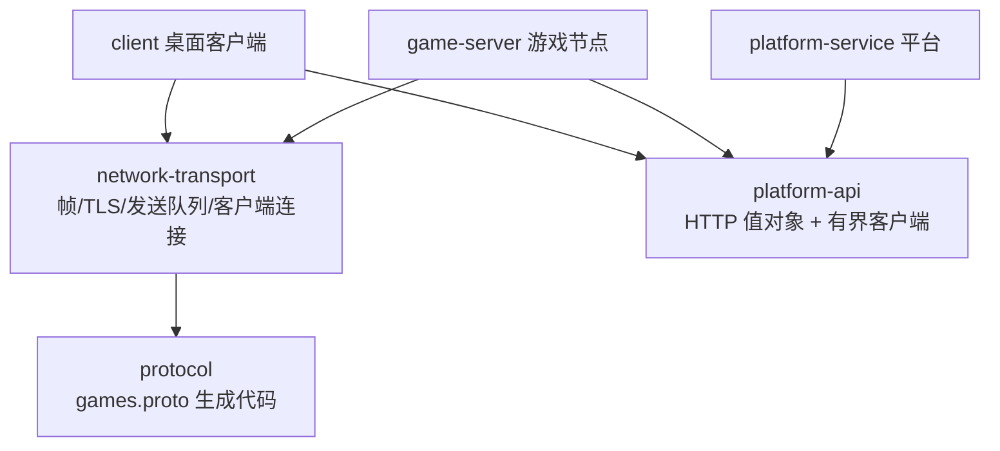

# 01 通信分层与协议

## 1. 模块分工



- `client` 的生产代码**不依赖** `game-server`。两端共享的只有 `protocol`（消息格式）和 `network-transport`（帧和 IO 工具）。`client` 只在测试中依赖 `game-server`，用于回环联机测试。
- `client` 和 `game-server` 只依赖 `platform-api`，**不带 Spring 或 JDBC**。平台服务的实现细节不会泄漏到客户端和游戏节点。

## 2. 对局通道的帧格式

源码：[ProtocolPipeline](../network-transport/src/main/java/dev/gamecore/network/transport/ProtocolPipeline.java)

TCP 是字节流，一次 `read` 可能只读到半条消息，也可能读到好几条消息（分包与粘包）。所以每条 Protobuf 消息前面加 4 字节大端长度：

```
+----------------+------------------------------+
| 长度 N (4 字节) | Protobuf 正文 (N 字节，≤ 64 KiB) |
+----------------+------------------------------+
```

客户端和服务器安装同一套 Pipeline：

```java
public static <T extends MessageLite> void install(ChannelPipeline pipeline, Parser<T> parser, int maximum) {
    if (maximum < 256 || maximum > 65_536) { throw new IllegalArgumentException("Invalid frame limit"); }
    // 入站：按长度切帧，超长直接失败
    pipeline.addLast("frame", new LengthFieldBasedFrameDecoder(maximum + 4, 0, 4, 0, 4, true));
    // 入站：解析 Protobuf，限制递归深度和大小
    pipeline.addLast("protobufDecode", new MessageToMessageDecoder<ByteBuf>() {
        protected void decode(ChannelHandlerContext ctx, ByteBuf input, List<Object> output) throws Exception {
            byte[] bytes = new byte[input.readableBytes()]; input.readBytes(bytes);
            var coded = CodedInputStream.newInstance(bytes); coded.setRecursionLimit(16); coded.setSizeLimit(maximum);
            output.add(parser.parseFrom(coded));
        }
    });
    // 出站：写长度前缀，发送前检查大小
    pipeline.addLast("length", new LengthFieldPrepender(4));
    pipeline.addLast("protobufEncode", new MessageToByteEncoder<MessageLite>(MessageLite.class) { … });
}
```

帧层与游戏无关：Parser 和上限由端点传入，长度字段和缓冲区释放策略完全共享。分包、粘包、超长帧、畸形 Protobuf 的处理由 `MultiProtocolTest`、`TransportBoundaryTest` 验证。

## 3. 消息信封

源码：[games.proto](../protocol/src/main/proto/games.proto)

所有消息都包在同一个 `Envelope` 里，用 `oneof` 区分类型：

```protobuf
message Envelope {
  uint32 protocol_version = 1;   // 当前为 2，不符即断开
  uint64 request_id = 2;         // 请求编号，用于关联应答（如心跳往返时间）
  oneof payload {
    Hello hello = 10;        Welcome welcome = 11;      // 握手
    Join join = 12;          Joined joined = 13;        // 入场
    Input input = 14;        Snapshot snapshot = 15;    // 输入与快照
    EventBatch events = 16;  Result result = 17;        // 事件与结果
    Error error = 18;        Heartbeat heartbeat = 19;  // 错误与心跳
    RoomControl control = 20; RoomState room_state = 21; // 房间控制
  }
}
```

| 消息 | 方向 | 作用 |
| --- | --- | --- |
| `Hello` / `Welcome` | C→S / S→C | 握手；服务器返回连接 ID、连接凭证、支持的游戏列表、是否支持房间控制 |
| `Join` / `Joined` | C→S / S→C | 入场；携带房间、游戏 ID、版本、连接凭证、**平台票据**；返回比赛 ID、槽位、规则配置 |
| `RoomControl` / `RoomState` | C→S / S→C | 选择、准备、暂停、继续、重开、跳过开场 / 房间阶段、配置修订号、输入世代、各座位状态 |
| `Input` | C→S | 一条输入：序号、目标 Tick、输入世代、**不透明的游戏命令字节** |
| `Snapshot` | S→C | 服务器 Tick、规则 Tick、状态、**不透明的游戏快照字节**、确认、状态哈希 |
| `EventBatch` / `Result` | S→C | 本步事件 / 终局结果与最终快照 |
| `Error` | S→C | 稳定错误码（如 `LATE_INPUT`、`ROOM_FULL`） |
| `Heartbeat` | 双向 | 保活和测量往返时间 |

`Input.command` 和 `Snapshot.state` 是 `bytes`。外层协议**不认识任何游戏**，内层由各游戏的编解码器读写（见 [02 架构 · 在线扩展点](../02-可扩展游戏平台架构/03-在线扩展点.md#6-协议外层通用内层按游戏)）。

**协议演进规则**：只追加新字段号，不修改、不复用已发布字段的含义。`ProtocolContractTest` 用“黄金字节”检查已有字段编号没有被改动。

## 4. 线程归属

### 服务器端

源码：[NettyMultiGameServer](../game-server/src/main/java/dev/gamecore/server/multigame/NettyMultiGameServer.java)

```java
new ServerBootstrap().group(accept, io).channel(NioServerSocketChannel.class)
    .childOption(ChannelOption.TCP_NODELAY, true)
    .childOption(ChannelOption.WRITE_BUFFER_WATER_MARK, new WriteBufferWaterMark(32768, 65536))
    .childHandler(new ChannelInitializer<SocketChannel>() {
        protected void initChannel(SocketChannel ch) {
            if (connections.incrementAndGet() > limits.maxConnections()) { …; ch.close(); return; }   // 连接上限
            if (tls != null) { var ssl = tls.newHandler(ch.alloc()); ssl.setHandshakeTimeoutMillis(5000); ch.pipeline().addLast("tls", ssl); }
            ch.pipeline().addLast("readTimeout", new ReadTimeoutHandler(10));
            ch.pipeline().addLast("writeTimeout", new WriteTimeoutHandler(3));
            ProtocolPipeline.install(ch.pipeline(), GameProtocol.Envelope.parser(), ProtocolValues.MAX_FRAME);
            ch.pipeline().addLast("games", server.new Handler(peer));
        }
    });
```

| 线程 | 做什么 | 不做什么 |
| --- | --- | --- |
| Netty `games-io` EventLoop | TLS、切帧、解析、外层字段校验、限流、把消息投进房间邮箱、发送 | 不调用 `tick()`，不读写游戏世界 |
| 房间分片线程（1–8 个） | 从邮箱取输入和控制，校验后推进 `GameInstance`，编码快照 | 不做阻塞 IO |
| `platform-outbox` 等后台线程 | 票据兑换、结果提交（HTTP）、录像写盘 | 不碰世界 |

### 客户端

源码：[GameNetworkConnection](../network-transport/src/main/java/dev/gamecore/network/transport/GameNetworkConnection.java)

```java
/** 网络回调只写 64 控制事件 + 1 最新快照邮箱；open/closeAsync 不阻塞渲染线程。 */
private final ArrayBlockingQueue<GameProtocol.Envelope> events = new ArrayBlockingQueue<>(64);
private final AtomicReference<ReceivedSnapshot> latest = new AtomicReference<>();   // 只保留最新一份
```

Netty 线程收到消息后只写这两个位置。渲染线程每帧调用 `RemoteArenaSession.update()` 去读取，所以界面对象永远只在渲染线程上被修改（`RemoteArenaSession` 会检查调用线程）。

## 5. 背压与容量

源码：[AsyncOutbound](../network-transport/src/main/java/dev/gamecore/network/transport/AsyncOutbound.java)

服务器给每个连接配一个发送队列：

```java
public static final int CAPACITY = 128;
public void reliable(M value) { if (!reliable.offer(value)) { fatal.run(); } else { signal(); } }  // 可靠消息满了就断开
public void snapshot(M value) { latest.set(value); signal(); }                                    // 快照只保留最新一份
```

客户端网速慢时，旧快照被新快照覆盖，不会越积越多。可靠消息（`Joined`、`RoomState`、`Result`）不能丢，溢出就断开连接，而不是悄悄丢弃。每次最多发送 8 条可靠消息加 1 份快照，并且可靠消息总是先于快照发出，保证新一局的 `Joined` 先到，旧局的快照不会被当成新局的。

| 对象 | 上限 | 超限时 |
| --- | --- | --- |
| 单帧大小 | 64 KiB（Protobuf 递归深度 16） | 断开 |
| 每连接消息频率 | 240 条/秒；其中输入 120、控制 16、心跳 4 | `RATE_LIMIT` 等错误后断开 |
| 入场等待 | 3 秒（平台模式 8 秒） | `JOIN_TIMEOUT` |
| 读空闲 / 写阻塞 | 10 秒 / 3 秒 | 断开 |
| 服务器发送队列 | 可靠 128 条 + 最新快照 1 份 | 合并快照；可靠溢出断开 |
| 客户端接收邮箱 | 控制事件 64 条 + 最新快照 1 份 | 合并快照 |
| 单条输入命令 | 256 字节 | `BAD_INPUT` |
| 平台 HTTP 响应体 | 256 KiB，超时 4 秒 | `RESPONSE_LIMIT` / `PLATFORM_TIMEOUT` |
