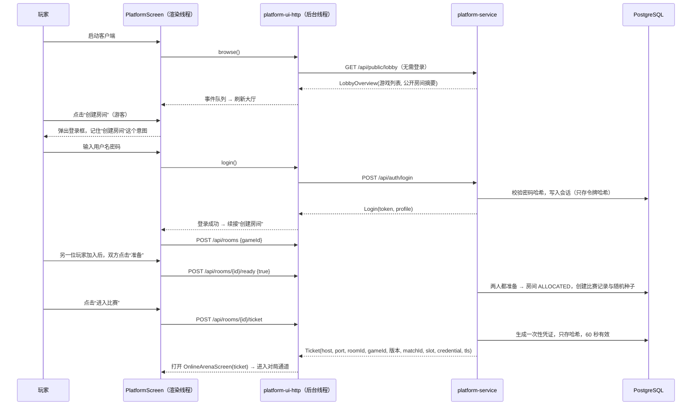

# 02 客户端大厅与平台交互

本篇说明玩家从打开客户端到拿到入场票据之间，客户端和平台服务之间发生了什么。

## 1. 整体流程



## 2. 平台地址从哪里来

源码：[PlatformEndpoint](../client/src/main/java/dev/gamecore/client/platform/PlatformEndpoint.java)、[PlatformHttpClient.endpoint](../platform-api/src/main/java/dev/gamecore/platform/api/PlatformHttpClient.java)

客户端按以下优先级读取平台地址：系统属性 `gamecore.platform.url` → 环境变量 `GAMECORE_PLATFORM_URL` → 构建时 `-PplatformUrl=...` 生成的资源。地址先做纯值校验：

```java
public static URI endpoint(String url) {
    URI base = URI.create(Objects.requireNonNull(url));
    if (base.getHost() == null || base.getUserInfo() != null || base.getQuery() != null || …
            || !("https".equals(base.getScheme())
                 || "http".equals(base.getScheme()) && Set.of("127.0.0.1", "localhost", "[::1]", "::1").contains(base.getHost()))) {
        throw new IllegalArgumentException("平台地址须为HTTPS；HTTP只允许回环开发地址");
    }
    return base;
}
```

- 公网只能用 HTTPS，HTTP 只允许本机开发地址。
- 地址未配置或无效时，大厅只显示提示，**不猜测地址**，也不会创建 HTTP 客户端。
- 设置 `gamecore.offline=true`（或 `GAMECORE_OFFLINE`）直接进入本地首页，本地三款游戏完全不依赖平台。

## 3. 客户端怎样发请求而不卡住界面

源码：[PlatformScreen](../client/src/main/java/dev/gamecore/client/screen/PlatformScreen.java)

HTTP 请求可能要等几秒，绝不能在渲染线程里等。大厅页面有一个**单线程、队列长度 16** 的后台工作者，结果通过一个长度 32 的事件队列交回渲染线程：

```java
private final ThreadPoolExecutor worker = new ThreadPoolExecutor(1, 1, 0, TimeUnit.SECONDS,
        new ArrayBlockingQueue<>(16), r -> new Thread(r, "platform-ui-http"), new ThreadPoolExecutor.AbortPolicy());
private final ArrayBlockingQueue<Runnable> events = new ArrayBlockingQueue<>(32);

private <T> void request(Callable<T> action, Consumer<T> done, String pending) {
    if (busy || leaving) { return; }                  // 请求进行中时忽略重复点击
    requestState(true); feedback(pending);            // 禁用按钮，显示“正在处理”
    worker.execute(() -> {
        T value = action.call();                      // 后台线程：真正的 HTTP 调用
        offer(() -> { requestState(false); done.accept(value); });   // 回到渲染线程更新界面
    });
}
```

各个按钮都调用这个方法，例如：

```java
// 创建房间
request(() -> session.client().call("POST", "/api/rooms", new CreateRoom(game.id()), Room.class), …);
// 准备 / 取消准备
request(() -> session.client().call("POST", "/api/rooms/" + room.id() + "/ready", new Ready(!ready), Room.class), …);
// 领取入场票据，然后打开在线对局页面
request(() -> session.client().call("POST", "/api/rooms/" + room.id() + "/ticket", null, Ticket.class), app::platformPlay);
```

## 4. HTTP 客户端：超时、上限、错误码

源码：[PlatformHttpClient](../platform-api/src/main/java/dev/gamecore/platform/api/PlatformHttpClient.java)

```java
http = HttpClient.newBuilder().connectTimeout(Duration.ofSeconds(2))
        .followRedirects(HttpClient.Redirect.NEVER).build();            // 不跟随重定向

private <T> T call(String method, String path, Object body, Class<T> type, boolean internal) {
    if (!path.startsWith("/api/") || path.contains("..") || path.length() > 256) { throw new IllegalArgumentException("API path"); }
    var builder = HttpRequest.newBuilder(base.resolve(path)).timeout(Duration.ofSeconds(4)) …;
    if (!auth.isEmpty()) {
        // 玩家用 Bearer 令牌；游戏节点用独立的服务器密钥
        builder.header(internal ? "X-Game-Server-Key" : "Authorization", internal ? auth : "Bearer " + auth);
    }
    var pending = http.sendAsync(request, ignored -> new LimitedBody());   // 响应体超过 256 KiB 立即取消
    …
    if (response.statusCode() / 100 != 2) { throw new Failure(response.statusCode(), code); }   // 只携带稳定错误码
    return JSON.readValue(bytes, type);
}
```

同一个类同时给客户端（玩家身份）和游戏节点（服务器身份）使用。`Failure` 只携带状态码和错误码，`Credentials`、`Login`、`Ticket` 的 `toString()` 都输出 `REDACTED`，密码和令牌不会出现在日志里。

## 5. 平台接口一览

源码：[PlatformController](../platform-service/src/main/java/dev/gamecore/platform/PlatformController.java)、[PlatformMessages](../platform-api/src/main/java/dev/gamecore/platform/api/PlatformMessages.java)

| 方法与路径 | 谁能调用 | 作用 |
| --- | --- | --- |
| `GET /api/public/lobby` | 任何人 | 公开大厅：游戏列表 + 最多 128 个房间摘要（不含账户、成员、比赛 ID、节点地址），1 秒缓存，独立限流 |
| `POST /api/auth/register`、`/login`、`/logout` | 任何人 / 玩家 | 注册、登录（返回令牌）、退出 |
| `GET/PUT /api/me` | 玩家 | 个人资料 |
| `GET /api/games`、`GET /api/rooms` | 玩家 | 游戏列表、房间列表 |
| `POST /api/rooms`、`/rooms/{id}/join`、`/ready`、`/leave` | 玩家 | 建房、加入、准备、退出 |
| `POST /api/rooms/{id}/ticket` | 房间成员 | 领取一次性入场票据 |
| `GET /api/history`、`/ranks/{game}`、`/matches/{id}` | 玩家 | 战绩、排行、比赛详情 |
| `/api/friends`、`/invitations`、`/rooms/{id}/invite` | 玩家 | 好友与邀请 |
| `POST /api/internal/tickets/redeem` | **仅游戏节点** | 兑换票据 → 受信的用户、槽位、比赛、种子 |
| `POST /api/internal/results` | **仅游戏节点** | 提交比赛结果 |
| `POST /api/internal/matches/{id}/active`、`/next` | **仅游戏节点** | 查询比赛是否有效、申请同房下一局 |

`internal` 接口由 [SecurityConfiguration](../platform-service/src/main/java/dev/gamecore/platform/SecurityConfiguration.java) 限定为 SERVER 角色，玩家的令牌调不通。

## 6. 入场票据

源码：[LobbyService.ticket / redeem](../platform-service/src/main/java/dev/gamecore/platform/LobbyService.java)

```java
// 领票：只有房间成员、且房间已分配比赛（双方都准备）才能领
public Ticket ticket(UUID uid, String id) {
    … require(r.status().equals("ALLOCATED"), 409, "NOT_READY");
    // 凭证随机生成，数据库只存哈希，60 秒过期
    INSERT INTO join_tickets(token_hash, match_id, user_id, slot, expires_at) VALUES (?, ?, ?, ?, now() + interval '60 seconds') …
    return new Ticket(host, port, id, t.id(), t.gameVersion(), t.rulesVersion(), r.matchId(), slot, credential, expires, tls);
}
// 兑换：游戏节点用服务器密钥调用；未过期、未使用的票据才能兑换，兑换后标记 consumed 并绑定连接 ID
public Admission redeem(Redeem body) { … UPDATE join_tickets SET consumed = true, connection_id = ? WHERE token_hash = ? … }
```

票据的设计要点：

- **客户端拿到的票据里有槽位，但游戏节点不信它。** 节点把票据交给平台兑换，用平台返回的 `Admission` 决定这个连接是谁、坐哪个槽位、属于哪场比赛。
- **一次性。** 兑换后立即作废，重放同一张票据会失败。
- **短期。** 60 秒过期。
- **只存哈希。** 数据库泄露也拿不到可用的凭证。

## 7. 会话与身份

源码：[PlatformSession](../client/src/main/java/dev/gamecore/client/platform/PlatformSession.java)

```java
/** 仅内存账户状态；密码/令牌不写设置文件。HTTP只由页面后台工作者调用，离线页面不依赖它。 */
public Profile login(String username, String password, boolean register) {
    if (register) { c.call("POST", "/api/auth/register", body, Profile.class); }
    var value = c.call("POST", "/api/auth/login", body, Login.class);
    … c.token(value.token()); profile = value.profile(); return profile;
}
public synchronized void expire() { if (client != null) { client.token(""); } profile = null; room = ""; }
```

- 令牌只保存在内存，关闭客户端即失效，不写入设置文件。
- 任意请求收到 401 时调用 `expire()` 清除身份，回到游客大厅。
- 游客点击“创建”或“加入”时，客户端记住这个明确意图，登录后只续接这一个操作。如果玩家在登录前切换了标签或浏览别的房间，旧意图被取消。

## 8. 开发账户的交互记录

开发账户 `testuser` 登录后，客户端在本机显示实时交互记录（实现见 [client 模块说明](../02-可扩展游戏平台架构/模块说明/client.md)）。它不改变协议，只在客户端读取已有的通信：

- 平台 HTTP：`PlatformHttpClient` 的观察端口记录方法、路径、状态码和耗时。失败请求标记为错误类型。登录请求返回之前客户端还不知道账户，所以登录请求本身不记录。
- 游戏服务器 TCP：在编解码之后、业务处理器之前安装只读旁路 `TrafficTapHandler`。回调在 EventLoop 上，只写有界内存，满额丢弃最旧一行。
- 其他账户和游客的连接管线与正式版本完全相同，没有旁路处理器。
- 记录里没有密码、令牌、握手凭证、平台票据和消息体。

## 9. 相关测试

| 测试 | 验证内容 |
| --- | --- |
| [PlatformHttpClientTest](../platform-api/src/test/java/dev/gamecore/platform/api/PlatformHttpClientTest.java) | 公网 HTTP 与含凭证地址被拒绝；响应体上限；卡住的响应会超时；敏感值不打印 |
| [PlatformEndpointTest](../client/src/test/java/dev/gamecore/client/platform/PlatformEndpointTest.java) | 地址来源优先级；未配置或无效时不创建客户端 |
| [PlatformSessionTest](../client/src/test/java/dev/gamecore/client/platform/PlatformSessionTest.java) | 默认游客大厅、显式离线；登录、退出失败时只清账户状态 |
| [AccountRulesTest](../platform-service/src/test/java/dev/gamecore/platform/AccountRulesTest.java) | 凭证随机、令牌只存哈希、用户名规范化 |
| [PublicLobbyBudgetTest](../platform-service/src/test/java/dev/gamecore/platform/PublicLobbyBudgetTest.java) | 公开大厅与认证的限流相互独立且有界 |
| [PlatformIntegrationTest](../platform-service/src/test/java/dev/gamecore/platform/PlatformIntegrationTest.java) | 真实 PostgreSQL：注册登录、权限隔离、票据兑换、结果幂等 |
| [TrafficCaptureIntegrationTest](../client/src/test/java/dev/gamecore/client/traffic/TrafficCaptureIntegrationTest.java) | 回环真实连接上的交互记录：v2 与 v1 消息类型、连接失败、平台请求、未开启时不安装旁路、记录不含凭证 |
| `:lwjgl3:trafficOverlaySmokeTest` | 真实窗口中的账户开关、拖动、点击隔离、跨页面、真实对局和退出登录 |
| `:lwjgl3:platformLobbySmokeTest`、`platformAuthFeedbackSmokeTest`、`platformUiSmokeTest` | 真实窗口中的游客大厅、登录续接、表单反馈、完整平台流程 |
