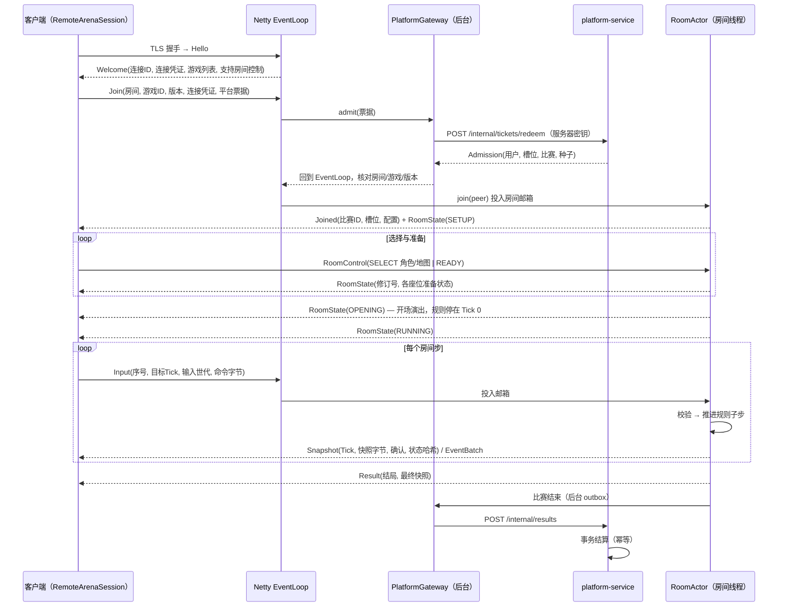

# 03 游戏过程中的交互

本篇从客户端拿着入场票据连接游戏节点开始，讲到比赛结果写入平台为止。三款游戏走的是同一套流程，下文以通用代码为主，个别地方注明游戏差异。

## 1. 整体时序



## 2. 握手与入场

### 客户端发起连接

源码：[RemoteArenaSession](../client/src/main/java/dev/gamecore/client/network/RemoteArenaSession.java)、[OnlineArenaScreen](../client/src/main/java/dev/gamecore/client/screen/OnlineArenaScreen.java)

```java
// OnlineArenaScreen（简化）：按票据中的游戏 ID 取工厂，用票据中的地址、房间、凭证和 TLS 标志建立远端会话
factory = GameRegistry.builtIn().require(game);
remote = new RemoteArenaSession(factory, ticket.host(), ticket.port(), ticket.roomId(), ticket.credential(), ticket.tls(), true);

// RemoteArenaSession：连接由 network-transport 创建，openTicket 不阻塞渲染线程
network = GameNetworkConnection.openTicket(host, port, room, t.id(), t.gameVersion(), t.rulesVersion(),
        ticket, null, tls, ca.isBlank() ? null : Path.of(ca), interactive);
```

TLS 使用 JDK 信任库验证证书链和主机名，没有“跳过校验”的选项。只有通过 `gamecore.tls.ca` 显式指定时才使用私有 CA。

### 服务器处理 Hello 和 Join

源码：[NettyMultiGameServer.Handler](../game-server/src/main/java/dev/gamecore/server/multigame/NettyMultiGameServer.java)

每条消息先经过统一的外层检查：

```java
if (++messages > 240) { peer.fail("RATE_LIMIT"); return; }                                   // 每秒消息上限
if (e.getProtocolVersion() != ProtocolValues.VERSION) { peer.fail("PROTOCOL_VERSION"); return; }
if (e.getRequestId() <= 0 || !e.getUnknownFields().asMap().isEmpty()) { peer.fail("INVALID_ENVELOPE"); return; }
```

收到 `Join` 时，平台模式下**不信任客户端声明的槽位**，而是交给后台网关兑换票据：

```java
if (!j.getCredential().equals(peer.credential)) { peer.fail("CREDENTIAL"); return; }    // 必须是本连接 Welcome 中发的凭证
if (platform != null) {
    platform.admit(j.getPlatformTicket(), peer.id).whenComplete((admission, failure) -> {
        ctx.executor().execute(() -> {                                                  // 结果回到本连接的 EventLoop
            if (failure != null || !admission.roomId().equals(j.getRoomId())
                    || !admission.gameId().equals(j.getGameId()) || … ) { peer.fail("PLATFORM_ADMISSION_FAILED"); return; }
            peer.slot = admission.slot(); peer.match = admission.matchId();              // 槽位和比赛来自平台
            peer.room = host.require(admission.roomId());
            if (!peer.room.join(peer, e.getRequestId())) { peer.fail("CONTROL_QUEUE_FULL"); }
        });
    });
    return;
}
```

源码：[PlatformGateway.admit](../game-server/src/main/java/dev/gamecore/server/platform/PlatformGateway.java)

```java
workers.execute(() -> {                                                                 // 有界后台线程，不占 EventLoop
    if (live.size() + diskPending.get() >= 64) { throw new IllegalStateException("Platform backlog"); }
    var a = http.internal("/api/internal/tickets/redeem", new Redeem(ticket, connection), Admission.class);
    var f = games.require(a.gameId());                                                  // 校验游戏版本
    …
    rooms.ensure(new RoomHost.Spec(a.roomId(), a.gameId(), f.defaults(), a.seed()));   // 按需创建房间，种子来自平台
    answer.complete(a);
});
```

### 房间接纳玩家

源码：[RoomActor.joinOwned](../game-server/src/main/java/dev/gamecore/server/multigame/RoomActor.java)

```java
if (!status.equals("WAITING") || seats.size() >= config.players()) { peer.error("ROOM_FULL", …); return; }
if (game == null) { game = GameInstance.create(factory, config, seed); … }           // 世界在房间线程上创建
int slot = peer.reservedSlot();                                                    // 使用平台分配的槽位
if (slot >= config.players() || hasSlot(slot)) { peer.error("SLOT_CONFLICT", …); return; }
peer.reliable(… setJoined(Joined{roomId, matchId, playerSlot, game, config}) …);
if (seats.size() == config.players() && interactive) { status = "SETUP"; }         // 两人到齐，进入选择阶段
```

## 3. 选择、准备、开场

两人到齐后房间进入 `SETUP`。客户端通过 `RoomControl` 提交操作：

```protobuf
enum RoomAction { SELECT = 1; READY = 2; UNREADY = 3; PAUSE = 4; RESUME = 5; RESTART = 6; CANCEL_RESTART = 7; SKIP_OPENING = 8; }
message RoomControl { string room_id = 1; string match_id = 2; uint64 sequence = 3; uint64 revision = 4; RoomAction action = 5; repeated Option choices = 6; }
```

| 机制 | 作用 |
| --- | --- |
| **槽位由连接决定** | `RoomControl` 中没有槽位字段，房间按连接查座位 |
| **选择白名单** | `SELECT` 交给游戏工厂的 `select(current, slot, choices)` 校验，例如格斗中 P2 不能选地图 |
| **修订号 `revision`** | 每次配置变化加 1。`READY` 必须针对当前修订号，对方改了选择，自己之前的准备就失效 |
| **控制序号** | 每个座位的控制序号必须递增，否则返回 `STALE_CONTROL` |
| **开场 `OPENING`** | 双方准备后进入开场，持续 `openingMillis()`（格斗 7650 ms，其余为 0）。期间规则停在 READY、Tick 为 0 |

## 4. 输入：从按键到规则

### 客户端：选择目标 Tick

源码：[ArenaInputSchedule](../client/src/main/java/dev/gamecore/client/network/ArenaInputSchedule.java)

输入必须指定“在哪个 Tick 生效”。目标太早会被判迟到，太晚会让操作变迟钝。客户端根据往返时间和快照年龄估算：

```java
long target(long now, int tps, long tick, long arrival, long rtt, boolean force) {
    long period = 1_000_000_000L / tps;
    if (!force && now < nextDue) { return 0; }                       // 按房间节拍采样，低帧率也不补发
    long age = Math.min(1_000_000_000L, Math.max(0, now - arrival)); // 最新快照已经过去多久
    long transit = rtt > 0 ? Math.min(rtt, 2_000_000_000L) : 100_000_000L;
    long window = Math.max(2, tps / 2);                              // 与服务器允许的未来窗口一致
    long lead = Math.min(window, Math.max(1, (transit + age + marginTicks() * period + period - 1) / period));
    long target = Math.max(lastTarget + 1, tick + lead);
    if (target > tick + window) { return 0; }                        // 超出窗口就不发
    …
    return target;
}
```

`RemoteArenaSession.update()` 每帧调用它，得到目标后采样按键、编码并发送：

```java
long target = inputSchedule.target(now, roomTps, snapshot.getServerTick(), snapshotArrival, network.rttNanos(), false);
if (target > 0) {
    byte[] command = commands.get();                    // 由各游戏的 OnlineGameView 采样并编码
    if (command != null) { factory.inputs().decode(command); network.input(++sequence, target, command); }
}
```

### 服务器：网络线程的轻量检查

```java
if (++inputs > 120) { peer.fail("INPUT_RATE"); return; }
if (input.getCommand().size() > ProtocolValues.MAX_INPUT || input.getCommand().isEmpty()) { throw new IllegalArgumentException(); }
peer.room.factory().inputs().decode(input.getCommand().toByteArray());   // 纯值解码可以在 IO 线程做
if (!peer.room.input(peer, input)) { peer.error("INPUT_QUEUE_FULL", …); } // 投入有界邮箱，世界由房间推进
```

### 服务器：房间线程的完整校验

源码：[RoomActor.accept](../game-server/src/main/java/dev/gamecore/server/multigame/RoomActor.java)

```java
if (seat == null || !peer.active() || !status.equals("RUNNING"))                       error = "NOT_RUNNING";
else if (!roomId.equals(id) || !matchId.equals(match) || !gameId.equals(factory.type().id())) error = "WRONG_GAME_OR_MATCH";
else if (sequence <= 0 || sequence <= seat.received)                                   error = "DUPLICATE_INPUT";
else if (targetTick <= tick)                                                           error = "LATE_INPUT";
else if (targetTick > tick + Math.max(2, roomTps / 2) || targetTick < seat.lastTarget) error = "FUTURE_INPUT";
else if (interactive && inputEpoch != this.inputEpoch)                                 error = "STALE_INPUT_EPOCH";
else game.validateInput(command);                                                      // 交给游戏编解码器校验内容
```

通过后按目标 Tick 放进该座位的未来队列。

### 推进一步

```java
private void advance() {
    long next = tick + 1;
    // 取出所有目标 Tick ≤ next 的输入
    for (var seat : seats) { while (!seat.future.isEmpty() && seat.future.firstKey() <= next) { selected.put(seat, …); } }
    int substeps = factory.type().simulationTps() / config.roomTps();       // Tank：60/30 = 2 个子步
    for (int part = 0; part < substeps; part++) {
        for (var seat : seats) {
            var input = part == 0 ? selected.get(seat) : null;
            // 没有新输入：短时间内沿用 held 命令；租约过期则发送 neutral（空闲）命令
            byte[] command = input != null ? input.getCommand().toByteArray()
                    : (next - seat.lastApplied <= Math.max(1, roomTps / 2) ? seat.held : game.neutral());
            if (command != null) { inputs.add(new AppliedInput(seat.slot, …, ++canonical, command)); seat.held = game.held(command); }
        }
        last = game.step(inputs);                                            // 解码 → submitInput → tick → 编码快照
        if (last.state() == SessionState.FINISHED) { break; }
    }
    tick = next;
    selected.forEach((seat, input) -> seat.executed = input.getSequence()); // 实际执行后才更新 executed 确认
    …
}
```

### 两种确认

快照中携带每个座位的 `Ack { received, executed }`：

- `received`：服务器已收到并排进队列的最大序号。
- `executed`：已经**实际用于规则推进**的最大序号。

输入排进了未来队列只算 `received`，不算 `executed`。客户端据此判断哪些输入真正生效了（`InputAcknowledgementTest`、`RoomActorTest.ackOnlyAfterExecutionAndDuplicatesDoNotRepeat`）。

## 5. 快照：接收、校验、平滑显示

### 客户端校验

源码：[RemoteArenaSession.apply](../client/src/main/java/dev/gamecore/client/network/RemoteArenaSession.java)

```java
if (!value.getMatchId().equals(match)) { return; }                                   // 旧比赛的快照直接丢弃
if (snapshot != null && value.getServerTick() < snapshot.getServerTick()) { return; } // Tick 不能倒退
if (!value.getGameId().equals(factory.type().id())
        || !Arrays.equals(StateHashes.hash(id, rulesVersion, value.getState().toByteArray()), value.getStateHash().toByteArray())) {
    throw new IllegalArgumentException("State identity/hash");                         // 游戏不符或哈希不符 → 安全断开
}
```

任何解析或校验异常都在 `update()` 中被捕获，页面显示“收到无效游戏数据，已安全断开”，不会把异常抛进渲染循环。

### 平滑显示

源码：[ArenaSnapshotTimeline](../client/src/main/java/dev/gamecore/client/network/sync/ArenaSnapshotTimeline.java)、[ArenaMotion](../client/src/main/java/dev/gamecore/client/network/sync/ArenaMotion.java)

快照到达的时间并不均匀。客户端保留最多 64 份快照，显示时间落后最新快照约一个快照间隔，在两份快照之间插值：

```java
public void offer(long tick, S value, long arrival) {
    if (!samples.isEmpty() && tick <= samples.lastKey()) { return; }   // 只接受更新的 Tick
    samples.put(tick, new Sample<>(value, arrival));
    while (samples.size() > CAPACITY) { samples.pollFirstEntry(); }     // 最多 64 份
}
public Frame<S> frame(long now) {
    … target = latest.tick - interval + (now - latest.arrival) × 60 / 1e9;   // 显示游标
    target = clamp(target, firstKey, latestKey);                              // 只插值，不外推
    …
}
```

`ArenaMotion` 只替换**坐标**这类连续量。生命、技能、命中、结果始终取最新的权威快照；格斗的瞬移、束缚、硬直直接显示权威值，避免把一次闪袭画成横穿场景的滑行。

## 6. 心跳与往返时间

```java
heartbeat = c.executor().scheduleAtFixedRate(this::ping, 1, 1, TimeUnit.SECONDS);    // 每秒一次
// 收到回应后用指数平滑更新 RTT
if (e.hasHeartbeat() && e.getRequestId() == heartbeatRequest) {
    long sample = System.nanoTime() - heartbeatSent;
    rttNanos = rttNanos == 0 ? sample : (3 * rttNanos + sample) / 4;
}
```

心跳同时用于保活：服务器 10 秒读不到任何消息就断开连接。RTT 用于第 4 节的目标 Tick 估算。

## 7. 暂停、重开与输入世代

| 操作 | 规则 |
| --- | --- |
| 暂停 | 任一方发送 `PAUSE`，房间暂停规则推进 |
| 继续 | 双方都发送 `RESUME` 后才恢复 |
| 重开 | 双方都确认 `RESTART` 后，当前比赛记为 `RESTARTED`（不计分），房间向平台申请新比赛 ID，回到选择阶段 |
| 输入世代 `inputEpoch` | 暂停、继续、重开、换局时加 1，同时清空房间里排队的输入 |

客户端发现 `RoomState.inputEpoch` 变化时，**先清空本地按键锁存，再允许采样**：

```java
if (roomState == null || state.getInputEpoch() != roomState.getInputEpoch()) { clearInput.run(); inputSchedule.reset(); }
```

这样暂停前按住的键不会在恢复后被当成新输入发出去，上一局的按键也不会带到下一局（`OnlineInputLifecycleTest`）。

## 8. 结算

比赛结束时，房间发送 `Result` 给双方，并通知平台网关。网关把结果放入有界的 outbox（最多 128 条），先落盘，再由后台线程提交：

```
POST /api/internal/results  { matchId, reason, snapshot(Base64) }   ← 服务器密钥
```

源码：[MatchService.finish](../platform-service/src/main/java/dev/gamecore/platform/MatchService.java)

```java
require(Set.of("RULES", "PLAYER_DISCONNECTED", "ROOM_CLOSED", "ROOM_FAILURE", "ADMISSION_DISCONNECTED", "RESTARTED").contains(body.reason()), …);
require(body.snapshot().length() <= 88000, 400, "SNAPSHOT_LIMIT");
snapshot = GameProtocol.Snapshot.parseFrom(Base64.getDecoder().decode(body.snapshot()));
… SELECT * FROM match_records WHERE id = ? FOR UPDATE …                      // 行锁，防止并发重复结算
require(lobby.serverId.equals(row.get("server_id")), 403, "WRONG_SERVER");  // 只接受分配到这场比赛的节点
```

- **只有服务器能提交结果**，客户端没有任何上传积分的接口。
- **幂等**：同一场比赛重复提交相同结果不会重复加分，提交冲突的结果被拒绝。
- **重开或中止不计分**：`RESTARTED`、`ABORTED` 的比赛不计入胜负。
- **已知边界**：如果节点在结果落盘之前被强制杀死，这一条结果会丢失。这是有意记录的窗口，没有宣称零丢失。

## 9. 断线与错误

| 情况 | 处理 |
| --- | --- |
| 客户端断网 | 心跳停止，服务器 10 秒后断开；房间中止比赛，另一方收到结果 |
| 服务器关闭 | 先向所有连接发送 `SERVER_SHUTDOWN`，给可靠消息最多 2 秒冲刷时间，再关闭 |
| 客户端发送非法数据 | 返回稳定错误码；入场前的错误直接断开 |
| 客户端收到非法数据 | `update()` 捕获异常，显示“已安全断开”，异步关闭连接 |
| 玩家退出页面 | 异步关闭连接、释放资源，返回平台大厅 |

## 10. 相关测试

| 测试 | 验证内容 |
| --- | --- |
| [RoomActorTest](../game-server/src/test/java/dev/gamecore/server/multigame/RoomActorTest.java) | 执行后才确认；重复、迟到、未来、跨游戏输入被拒绝；队列有硬上限 |
| [InteractiveRoomTest](../game-server/src/test/java/dev/gamecore/server/multigame/InteractiveRoomTest.java) | 选择白名单、双方准备前不开局、开场期间规则不推进 |
| [InteractiveNetworkTest](../game-server/src/test/java/dev/gamecore/server/multigame/InteractiveNetworkTest.java) | 真实网络中多轮对局，连接保持 |
| [MultiGameNetworkTest](../game-server/src/test/java/dev/gamecore/server/multigame/MultiGameNetworkTest.java) | 双端收到相同权威结果；多房间隔离；不兼容版本被拒绝；断线中止 |
| [PlatformGatewayTest](../game-server/src/test/java/dev/gamecore/server/platform/PlatformGatewayTest.java) | 未提交的结果在网关重启后继续重试，磁盘上不存凭证 |
| [RemoteArenaTest](../client/src/test/java/dev/gamecore/client/network/RemoteArenaTest.java) | 反复进出与断线后资源释放；失败不抛进渲染循环；终局结果不丢 |
| [OnlineInputLifecycleTest](../client/src/test/java/dev/gamecore/client/network/OnlineInputLifecycleTest.java) | 恢复采样前清除按键锁存 |
| [ArenaInputScheduleTest](../client/src/test/java/dev/gamecore/client/network/ArenaInputScheduleTest.java)、[ArenaMotionTest](../client/src/test/java/dev/gamecore/client/network/ArenaMotionTest.java)、[ArenaLatencyIntegrationTest](../client/src/test/java/dev/gamecore/client/network/ArenaLatencyIntegrationTest.java) | 目标 Tick 选择、坐标平滑、延迟下的整体表现 |
| [SnapshotCadenceTest](../game-server/src/test/java/dev/gamecore/server/multigame/SnapshotCadenceTest.java) | 提高快照频率不改变权威结果，并报告带宽成本 |
| `:lwjgl3:onlineArenaTest` | 三款游戏双客户端真实图形完整会话 |
