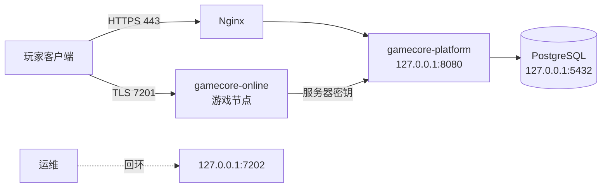

# 04 部署环境

本篇说明平台服务和游戏节点实际运行在哪里、开放哪些端口、受哪些资源限制。本机开发时两类服务都可以在回环地址上启动，不需要云主机。

## 1. 本机开发

```powershell
# 只做多游戏联机（不需要平台）：多游戏服务器监听 7200
.\gradlew.bat :game-server:run --args="multi --port=7200" --console=plain

# 本地玩法（不需要任何服务器）
.\gradlew.bat :lwjgl3:run "-Dgamecore.offline=true" --console=plain
```

带平台的完整流程需要一个本机 PostgreSQL 测试库，并用 `.\gradlew.bat :lwjgl3:run "-Dgamecore.platform.url=http://127.0.0.1:8080" --console=plain` 让客户端连接本机平台（PowerShell 中 `-D` 参数必须加引号）。HTTP 只允许回环地址，见 [02 · 平台地址](02-客户端大厅与平台交互.md#2-平台地址从哪里来)。

## 2. 云主机配置

| 项目 | 配置 |
| --- | --- |
| 云服务与地域 | 阿里云 ECS，华北2（北京） |
| 实例规格 | `ecs.e-c1m1.large` |
| 操作系统 | Ubuntu 22.04 64 位 |
| CPU / 内存 | 2 核 vCPU / 2 GiB |
| 公网 IP | `<服务器公网 IP>` |
| 公网带宽 | 3 Mbps |
| 系统盘 | ESSD Entry 云盘，40 GiB |
| 运行时 | OpenJDK 21、PostgreSQL 18.6、Nginx、Certbot |

## 3. 端口

以下均为 TCP。对外端口和仅供服务器内部使用的端口严格区分。

| 端口 | 服务 / 协议 | 访问范围 |
| --- | --- | --- |
| 22 | SSH | 运维 |
| 80 | HTTP | 只用于证书签发的 ACME 挑战，其他路径返回 404 |
| 443 | HTTPS 平台入口 | 公网；Nginx 反向代理到 `127.0.0.1:8080` |
| 7201 | TLS 游戏节点 | 公网；平台认证后的双人在线对战入口 |
| 8080 | 平台内部 HTTP | 仅回环；公网只能经 443 访问 |
| 5432 | PostgreSQL | 仅回环，不向玩家开放 |
| 7202 | 游戏节点健康检查 | 仅回环，只读 |



## 4. 服务运行方式

| 组件 | systemd 服务 | 运行身份与限制 |
| --- | --- | --- |
| 平台 | `gamecore-platform.service` | 独立低权限用户；堆上限 256 MiB，cgroup 上限 576 MiB |
| 游戏节点 | `gamecore-online.service` | 独立低权限用户；堆 128–512 MiB，cgroup 上限 896 MiB |
| 证书续期 | `gamecore-ip-renew.timer` | 每小时检查，续期后优雅重启游戏节点 |

- 发行包由 `:game-server:linuxRelease` 生成，带版本号、运维模板、许可和 SHA256 清单。部署时把 `/opt/gamecore/online` 链接切换到新版本目录。
- 密钥和数据库口令只在云主机上随机生成，权限 640，不进入仓库。
- 游戏节点的 TLS 证书是 Let's Encrypt 签发的公网 IP 证书，客户端使用系统默认信任库验证，没有自签证书或跳过校验。
- 回滚只切换游戏制品链接，不会自动降级数据库结构。

常用运维命令：

```bash
systemctl status gamecore-platform gamecore-online --no-pager
journalctl -u gamecore-platform -u gamecore-online -n 100 --no-pager
curl --fail http://127.0.0.1:8080/api/health
curl --fail http://127.0.0.1:7202/health
```

## 5. 服务器的资源限制

| 限制 | 含义 |
| --- | --- |
| 内存只有 2 GiB，多个服务共用 | 同时运行游戏节点、平台、PostgreSQL、Nginx。堆上限不等于进程实际内存（RSS），各服务上限相加也不是整机保证 |
| 公网带宽只有 3 Mbps | 本机负载工具测得 24 人预算组的应用层发送约 543.7 KiB/s（约 4.45 Mbps），还没算 TCP/IP 开销，已超过这台机器的带宽。所以不能用本机吞吐推算公网承载人数 |
| 存储只有 40 GiB | 系统、数据库、日志、录像、备份和多个发行版本共用，需要定期检查磁盘余量 |
| 游戏节点房间上限 | 部署配置限定同时活跃房间数和连接数；比赛结束但连接未断开时仍占用名额 |

## 6. 已验证与未验证

部署后实际做过的检查：两台电脑的双客户端公网对局、正式客户端默认连接平台、备份与恢复、优雅升级、端口可达性（8080/5432/7202 从公网不可达）、文件权限。详细结果见 阶段 11 验证记录。

没有做过的：公网压力测试、整机重启演练、证书热加载（续期时会重启节点）。这些不写成已通过。
