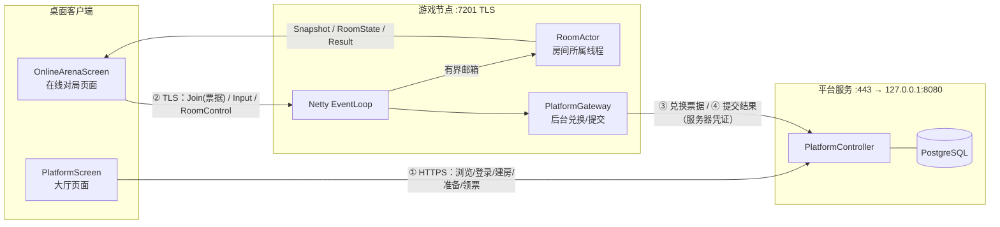

# 03 客户端与服务器网络通信

GameCore 的客户端要和两类服务器通信，两条通道分工不同：

| 通道 | 对端 | 协议 | 内容 | 特点 |
| --- | --- | --- | --- | --- |
| **大厅通道** | 平台服务 `platform-service` | HTTPS + JSON（REST） | 游客浏览、注册登录、建房/加入/准备、领取入场票据、战绩、好友 | 请求-响应，低频，有状态的业务数据存在 PostgreSQL |
| **对局通道** | 游戏节点 `game-server` | TLS + TCP 长连接，4 字节长度前缀 + Protobuf | 入场、房间控制、输入、快照、事件、结果、心跳 | 双向实时推送，服务器拥有权威世界 |

两条通道通过**一次性入场票据**衔接：客户端在大厅通道里领票，到对局通道上交票。游戏节点再用自己的服务器凭证向平台兑换，得到受信的用户、槽位和比赛身份。比赛结束后，游戏节点把结果提交回平台结算。

## 阅读顺序

| 文档 | 内容 |
| --- | --- |
| [01-通信分层与协议](01-通信分层与协议.md) | 模块分工、帧格式、Protobuf 信封、线程归属与容量上限 |
| [02-客户端大厅与平台交互](02-客户端大厅与平台交互.md) | 游客大厅、登录、建房准备、领票的完整流程与代码 |
| [03-游戏过程中的交互](03-游戏过程中的交互.md) | 握手入场、选择准备、输入与确认、快照与平滑、暂停重开、结算的完整流程与代码 |
| [04-部署环境](04-部署环境.md) | 端口、TLS、云主机配置与资源限制 |

## 三条贯穿全文的原则

1. **服务器权威。** 客户端只发送“想做什么”（输入意图），位置、生命、胜负、积分都由服务器的规则或平台的结算产生。客户端自报的槽位和玩家 ID 一律不信任。
2. **网络线程不碰世界。** Netty 的 EventLoop 只做解码、校验和投递；世界只在房间所属线程推进。客户端同理：网络回调只写邮箱，渲染线程读取。
3. **所有队列有上限。** 帧大小、输入队列、发送队列、快照缓存、HTTP 响应体都有硬上限，满了就拒绝、合并或断开，而不是无限增长。

## 相关代码模块

| 模块 | 作用 |
| --- | --- |
| [protocol](../protocol/src/main/proto/games.proto) | Protobuf 消息定义（对局通道） |
| [network-transport](../network-transport/src/main/java/dev/gamecore/network/transport/) | 客户端与服务器共享的帧编解码、TLS、异步发送队列、客户端连接 |
| [platform-api](../platform-api/src/main/java/dev/gamecore/platform/api/) | 平台 HTTP 的值对象和有界 HTTP 客户端（大厅通道） |
| [game-server](../game-server/src/main/java/dev/gamecore/server/) | Netty 服务器、房间、平台网关 |
| [platform-service](../platform-service/src/main/java/dev/gamecore/platform/) | Spring Boot 平台服务 |
| [client](../client/src/main/java/dev/gamecore/client/) | `platform/`（大厅会话）、`network/`（对局会话）、`screen/`（页面） |
