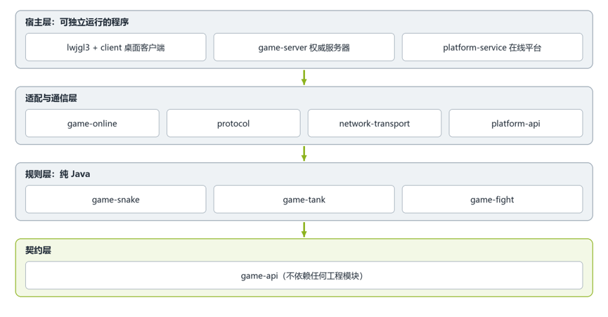

# GameCore：基于 Java 的可扩展多游戏竞技平台

GameCore 是一个用 Java 21 开发的多游戏竞技平台。它包含 libGDX 桌面客户端和三款玩法差异很大的游戏：网格类 **Snake Arena**、连续坐标射击类 **Tank Arena**、横版动作类 **终极格斗**。三款游戏都可以本地单人、人机或同屏双人游玩，也可以通过 Netty 权威游戏服务器和 Spring Boot 在线平台进行双人联机。

## 下载游玩

到本仓库的 **Releases** 页面下载 `GameCore-Windows-x64-*.zip`，完整解压后双击 `GameCore.exe` 即可。包内自带 Java 运行环境，无需安装 JDK；仅支持 Windows x64。

## 文档

| 主题 | 目录 | 内容 |
| --- | --- | --- |
| **可扩展游戏平台核心架构** | [02-可扩展游戏平台架构](02-可扩展游戏平台架构/README.md) | 扩展机制（契约、注册、类型擦除边界），三款游戏怎样接入，新增一款游戏的步骤，12 个模块的说明 |
| **客户端与服务器端的网络通信** | [03-客户端与服务器网络通信](03-客户端与服务器网络通信/README.md) | 通信分层与协议，客户端大厅与平台的交互，游戏过程中与服务器的交互，部署环境 |

## 架构一览



图中箭头表示层与层之间的依赖方向，只向下、不反向。上层不一定依赖下一层的全部模块，逐模块的直接依赖见下表。

| 模块 | 直接依赖的工程模块 |
| --- | --- |
| `lwjgl3` | `client` |
| `client` | `game-api`、三个规则模块、`game-online`、`network-transport`、`platform-api` |
| `game-server` | `game-api`、`game-tank`、`game-online`、`protocol`、`network-transport`、`platform-api` |
| `platform-service` | `game-online`、`platform-api` |
| `game-online` | `game-api`、三个规则模块、`protocol` |
| `network-transport` | `protocol` |
| `game-snake`、`game-tank`、`game-fight` | `game-api` |
| `game-api`、`protocol`、`platform-api` | 无 |

依赖只向内指：三个规则模块只依赖 `game-api`，编译期看不到图形、网络或数据库；客户端和服务器互不依赖，只通过协议交互。

## 构建与运行

需要 JDK 21；使用仓库自带的 Gradle Wrapper。

```powershell
# 编译并运行全部单元与集成测试
.\gradlew.bat clean build --console=plain

# 本地游玩（不需要服务器或登录）
.\gradlew.bat :lwjgl3:run "-Dgamecore.offline=true" --console=plain

# 本机联机：先启动多游戏服务器，再开两个客户端进入在线双人
.\gradlew.bat :game-server:run --args="multi --port=7200" --console=plain

# 连接自己部署的在线平台（游客大厅、注册登录、在线对局），部署方法见 03-客户端与服务器网络通信/04-部署环境.md
.\gradlew.bat :lwjgl3:run "-Dgamecore.platform.url=https://<你的平台地址>" --console=plain
```

在 PowerShell 中，`-D` 参数必须整体加引号，否则会被从点号处拆开，导致 Gradle 报错。

默认启动进入游客平台大厅。平台地址按 `gamecore.platform.url` 系统属性 → `GAMECORE_PLATFORM_URL` 环境变量 → 构建参数 `-PplatformUrl=https://...` 的顺序读取；未配置时只显示提示。公网地址必须是 HTTPS。

| 目录 | 内容 |
| --- | --- |
| `game-api`、`game-snake`、`game-tank`、`game-fight` | 契约与三款游戏的纯 Java 规则 |
| `game-online` | 三款游戏的联机适配与在线注册表 |
| `protocol`、`network-transport` | Protobuf 协议与共享网络层 |
| `client`、`lwjgl3` | 桌面客户端与启动入口 |
| `game-server` | Netty 权威游戏服务器、录像与开发工具 |
| `platform-api`、`platform-service` | 在线平台的 HTTP 契约与服务 |
| `assets` | 运行素材（字体、背景、角色、地图）及来源记录 |
| `deploy` | 部署配置模板、systemd 单元、运维脚本 |
| `scripts`、`tools` | 素材生成脚本、联机探测与压测工具 |
| `opensource_application` | 每个第三方项目的版本、许可、用法与限制 |
| [THIRD_PARTY_NOTICES.md](THIRD_PARTY_NOTICES.md) | 第三方组件声明 |

## 已知限制

- 只在 Windows 桌面与一台 2 核 2 GiB 云主机上验证过；其他操作系统、显卡与公网压测未验证。格斗角色等由 AI 生成的素材来源记录见 `assets/` 下的说明文件。

  
